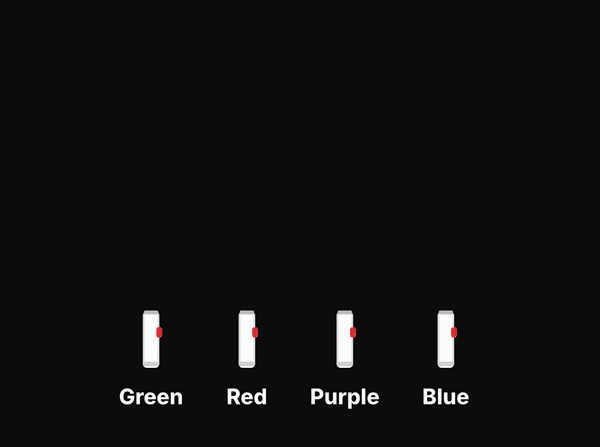
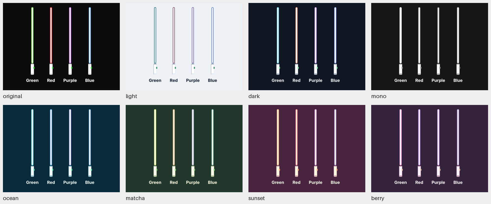

# Four pocket light wands

Four pocket-sized glowing props extend in sequence. Each white handle has a colored status switch and a short label below it.

| | |
| --- | --- |
| **Category** | [Games › Items](../) |
| **Size** | 576 × 429 CSS pixels, exported at 2× |
| **Colorways** | original, light, dark, mono, ocean, matcha, sunset, berry |
| **Fonts** | Inter, bundled under the SIL Open Font License |
| **Artwork** | Original SVG light props, glow filters and switch hardware. |
| **Animated** | Yes, 11.25-second loop at 24 fps |
| **Based on** | [A TikTok by @paulcodes4](https://www.tiktok.com/@paulcodes4/video/7696037041120857350) |

## Every colorway

## Files

- [Open the standalone design](source/design.html). Select a handle or its label to switch that light on and off.
- Add `#ocean` to switch palettes or `?t=5.77#ocean` to freeze the animation.
- [Exports](exports/) holds the colorway PNGs and H.264 loops.

## Changing it

Edit the palette variables at the top of [the source](source/design.html), then run `python3 .github/scripts/export_design.py games/items/four-pocket-light-wands` from the repository root.
