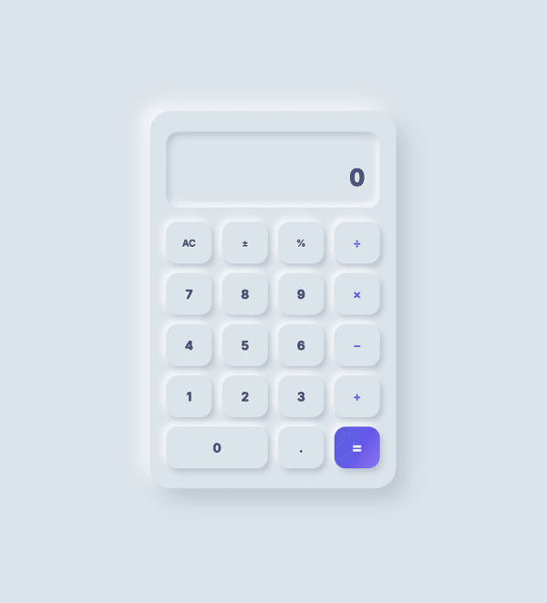
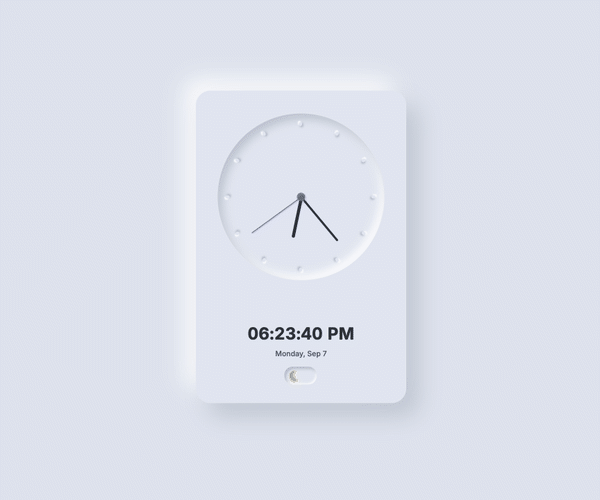

<!-- Generated by .github/scripts/build_catalog.py. Edit that file, not this one. -->
# Widgets

Mac widgets.

Part of [Mac](../).

## Designs (2)

<table>
<tr><td align="center" valign="top" width="33%"> <a href="soft-clay-calculator/"><b>Soft clay calculator</b></a> 8 colorways</td><td align="center" valign="top" width="33%"> <a href="soft-clay-clock/"><b>Soft clay clock</b></a> 8 colorways</td></tr>
</table>

Adding one? See [Adding a design](../../README.md#adding-a-design).
