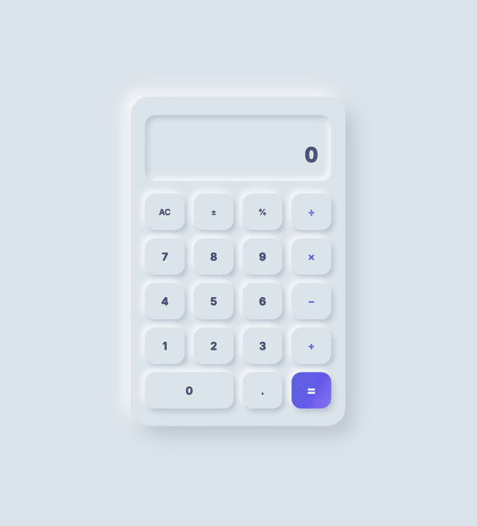
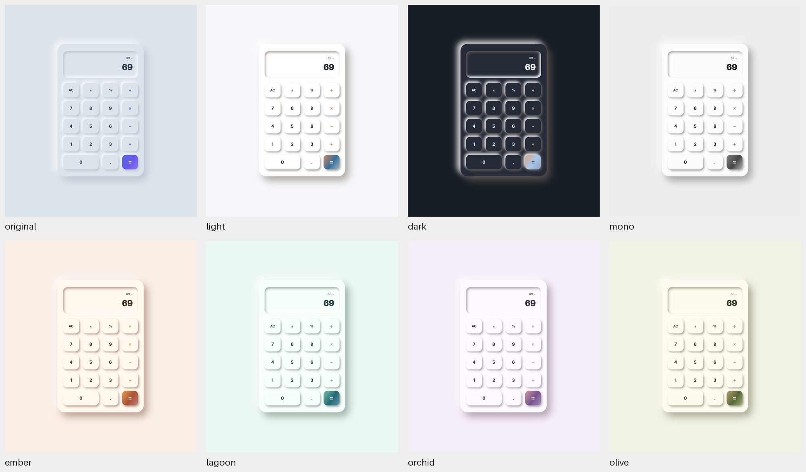

# Soft clay calculator

A violet equals key anchors a pale calculator with raised square keys and a recessed display. Its sample sequence enters an expression and shows the result.

| | |
| --- | --- |
| **Category** | [Mac › Widgets](../) |
| **Size** | 864 × 954 CSS pixels, exported at 2× |
| **Colorways** | original, light, dark, mono, ember, lagoon, orchid, olive |
| **Fonts** | Inter (bundled Latin subset from Google Fonts, SIL Open Font License) |
| **Icons** | Original inline SVG and CSS |
| **Animated** | Yes, 8-second loop at 24 fps |
| **Based on** | [A TikTok by @paulcodes4](https://www.tiktok.com/@paulcodes4/video/7698434684216413461) |

## Every colorway

## Files

- Open [the design](source/design.html) in a browser and append `#ember` to select that colorway. Add `?t=4.3#ember` after the filename to show the export still.
- [The exports folder](exports/) contains a PNG and an H.264 MP4 loop for each colorway.
- [The font folder](source/fonts/) includes the font files and their licenses.

## Changing it

The calculator supports mouse and keyboard input for the four basic operations, sign, percentage and decimal entry. Escape clears the expression and Enter evaluates it.

The custom properties at the top of `source/design.html` define each palette. Copy a palette block, give it a new colorway name, then run `python3 .github/scripts/export_design.py mac/widgets/soft-clay-calculator` from the repository root.
