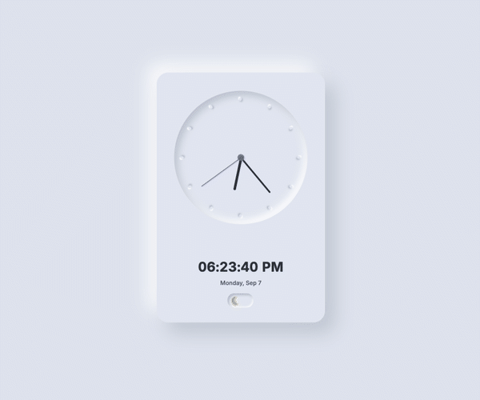
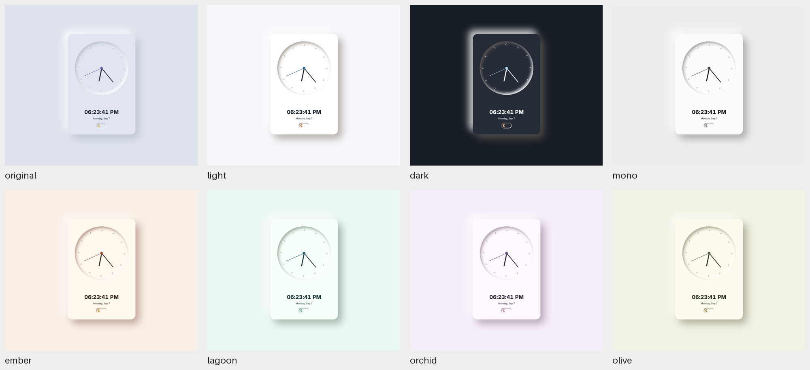

# Soft clay clock

A recessed analog dial sits in a soft extruded rectangle above a digital time, date and tiny moon control. Its light clay surface can switch to charcoal.

| | |
| --- | --- |
| **Category** | [Mac › Widgets](../) |
| **Size** | 864 × 720 CSS pixels, exported at 2× |
| **Colorways** | original, light, dark, mono, ember, lagoon, orchid, olive |
| **Fonts** | Inter (bundled Latin subset from Google Fonts, SIL Open Font License) |
| **Icons** | Original inline SVG and CSS |
| **Animated** | Yes, 6.5-second loop at 24 fps |
| **Based on** | [A TikTok by @paulcodes4](https://www.tiktok.com/@paulcodes4/video/7699905194506718484) |

## Every colorway

## Files

- Open [the design](source/design.html) in a browser and append `#ember` to select that colorway. Add `?t=2#ember` after the filename to show the export still.
- [The exports folder](exports/) contains a PNG and an H.264 MP4 loop for each colorway.
- [The font folder](source/fonts/) includes the font files and their licenses.

## Changing it

The little mode control changes the light or charcoal material. Click the time to swap the sample clock for local time. The face, markers, hands and shadows are native CSS and SVG.

The custom properties at the top of `source/design.html` define each palette. Copy a palette block, give it a new colorway name, then run `python3 .github/scripts/export_design.py mac/widgets/soft-clay-clock` from the repository root.
