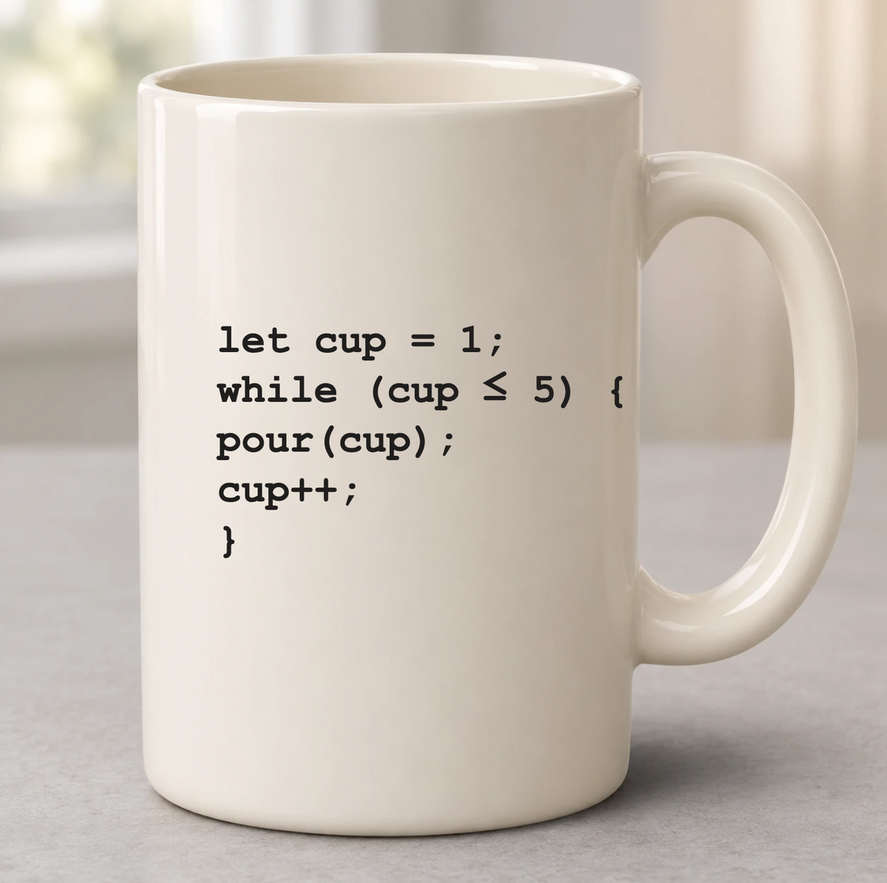
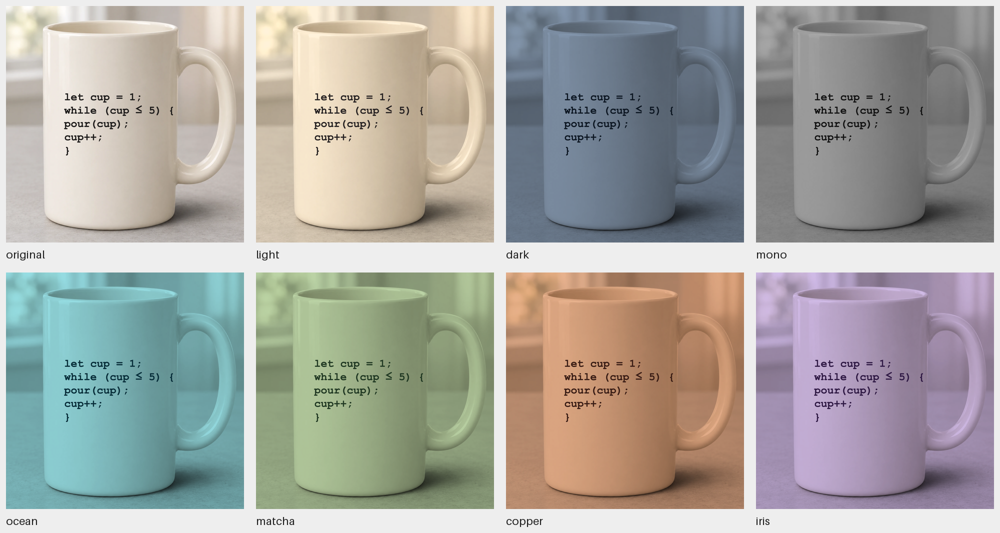

# Console loop mug

Five lines of dark monospace type sit on the front of a tall ceramic mug with a right-hand handle.

| | |
| --- | --- |
| **Category** | [Merch › Mugs](../) |
| **Size** | 1480 × 1472 |
| **Colorways** | original, light, dark, mono, ocean, matcha, copper, iris |
| **Fonts** | Courier New (system monospace) |
| **Artwork** | An original generated blank porcelain photograph and editable, illustrative code lettering |
| **Animated** | No |
| **Based on** | [A TikTok by @paulcodes4](https://www.tiktok.com/@paulcodes4/photo/7698719087941127444) |

## Every colorway

## Files

Open [the editable design](source/design.html) and append a colorway such as `#ocean` to its address. The [exports](exports/) contain the full-size PNGs.

## Changing it

The color blocks in the HTML control the palette. The type, placement and artwork are editable in the SVG. Run `python3 .github/scripts/export_design.py merch/mugs/console-loop-mug` after making a change.
