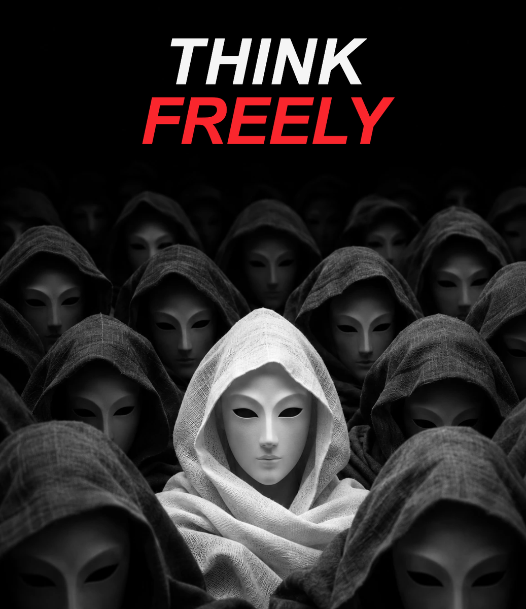
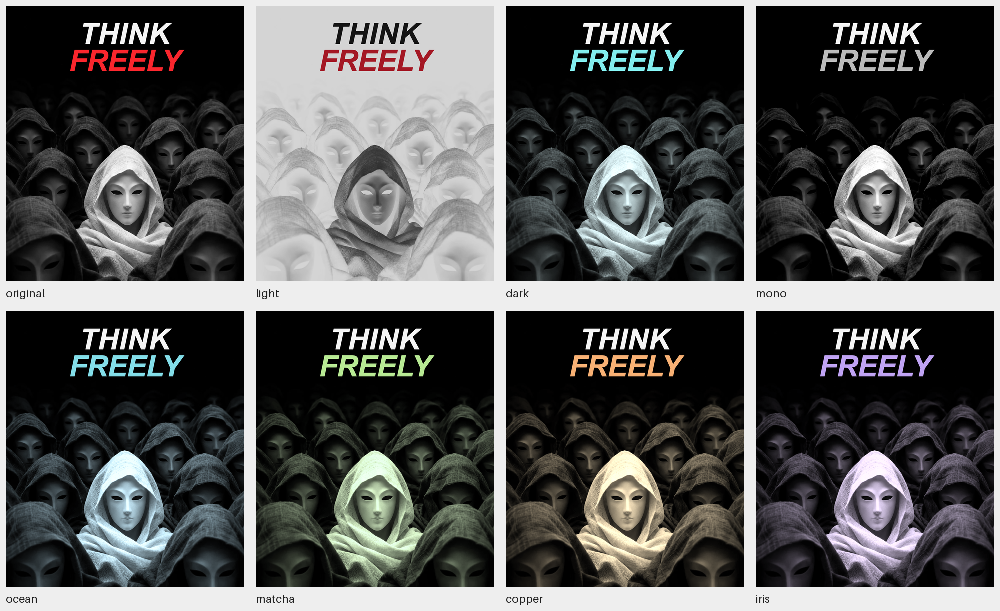

# Think freely crowd

One bright hood stands out from a monochrome crowd beneath two short lines of italic display type.

| | |
| --- | --- |
| **Category** | [Print › Posters](../) |
| **Size** | 1272 × 1472 |
| **Colorways** | original, light, dark, mono, ocean, matcha, copper, iris |
| **Fonts** | Arial (system sans-serif) |
| **Artwork** | An original generated theatrical-mask photograph and a new headline replace the recognizable reference imagery and wording |
| **Animated** | No |
| **Based on** | [A TikTok by @paulcodes4](https://www.tiktok.com/@paulcodes4/photo/7706905406676684084) |

## Every colorway

## Files

Open [the editable design](source/design.html) and append a colorway such as `#ocean` to its address. The [exports](exports/) contain the full-size PNGs.

## Changing it

The color blocks in the HTML control the palette. The type, placement and artwork are editable in the SVG. Run `python3 .github/scripts/export_design.py print/posters/think-freely-crowd` after making a change.
