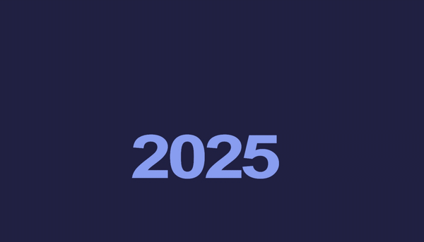

<!-- Generated by .github/scripts/build_catalog.py. Edit that file, not this one. -->
# New Year

New Year designs.

Part of [Seasonal](../).

## Designs (2)

<table>
<tr><td align="center" valign="top" width="33%"> <a href="balloon-year-rollover/"><b>Balloon year rollover</b></a> 8 colorways</td><td align="center" valign="top" width="33%"> <a href="ribbon-gift-reveal/"><b>Ribbon gift reveal</b></a> 8 colorways</td></tr>
</table>

Adding one? See [Adding a design](../../README.md#adding-a-design).
