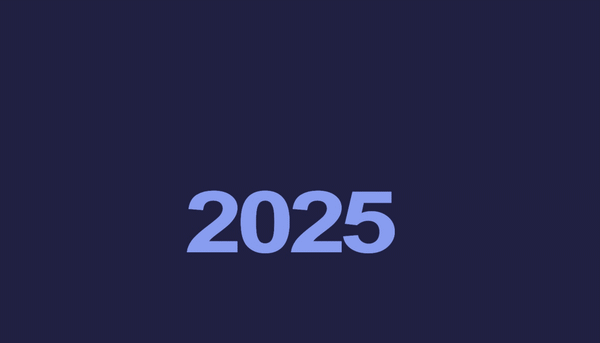
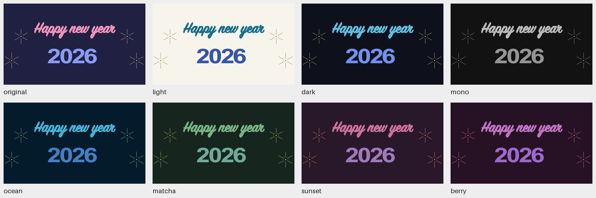

# Balloon year rollover

A gilded balloon lifts the outgoing five as the new year settles beneath a handwritten greeting and four sparklers.

| | |
| --- | --- |
| **Category** | [Seasonal › New Year](../) |
| **Size** | 576 × 329 CSS pixels, 2× export |
| **Colorways** | original, light, dark, mono, ocean, matcha, sunset, berry |
| **Fonts** | Arial, with SignPainter or a local cursive fallback for the greeting. |
| **Artwork** | Original procedural illustration and SVG geometry, drawn for Motherlode |
| **Animated** | Yes, 5.6-second loop |
| **Based on** | [A TikTok by @paulcodes4](https://www.tiktok.com/@paulcodes4/video/7696410322374069524) |

## Every colorway

## Files

- `source/design.html` is the standalone artwork. Its address accepts a palette such as `#matcha` and a preview time such as `?t=4.2#ocean`.
- `exports/` contains each palette’s PNG still and H.264 loop.

## Changing it

The year uses independent outgoing and incoming digits. Edit their travel, the balloon string or the greeting in the SVG script. The colorway blocks at the top of the source define the inks and ground. Run `python3 .github/scripts/export_design.py seasonal/new-year/balloon-year-rollover` to regenerate the exports.
