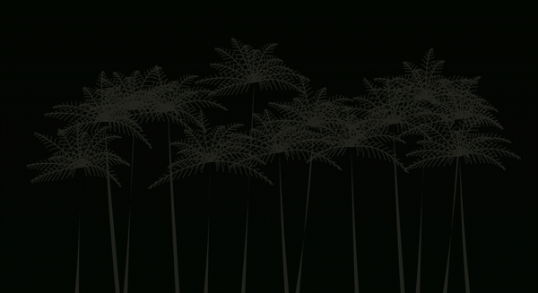
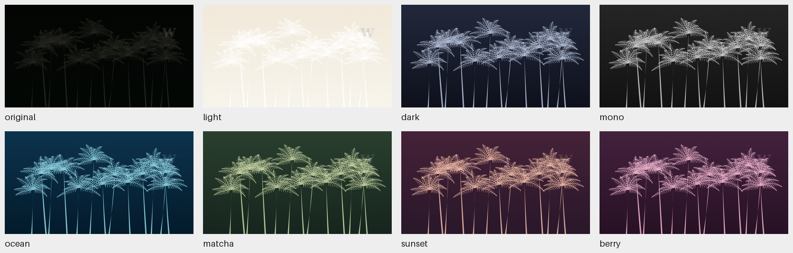

# Palm midnight letterworks

Slender palms stand against a near-black coast while rising rockets burst into colorful New Year letters.

| | |
| --- | --- |
| **Category** | [Seasonal › New Year](../) |
| **Size** | 576 × 314 CSS pixels, 2× export |
| **Colorways** | original, light, dark, mono, ocean, matcha, sunset, berry |
| **Fonts** | Georgia or the local serif fallback. |
| **Artwork** | Original procedural illustration and SVG geometry, drawn for Motherlode |
| **Animated** | Yes, 6.8-second loop |
| **Based on** | [A TikTok by @paulcodes4](https://www.tiktok.com/@paulcodes4/video/7695798829500681493) |

## Every colorway

## Files

- `source/design.html` is the standalone artwork. Its address accepts a palette such as `#matcha` and a preview time such as `?t=3.6#ocean`.
- `exports/` contains each palette’s PNG still and H.264 loop.

## Changing it

The three rocket volleys spell HAPPY, NEW and YEAR. Each palm has hand-shaped fronds with pairs of tapering leaflets. The colorway blocks at the top of the source define the inks and ground. Run `python3 .github/scripts/export_design.py seasonal/new-year/palm-midnight-letterworks` to regenerate the exports.
