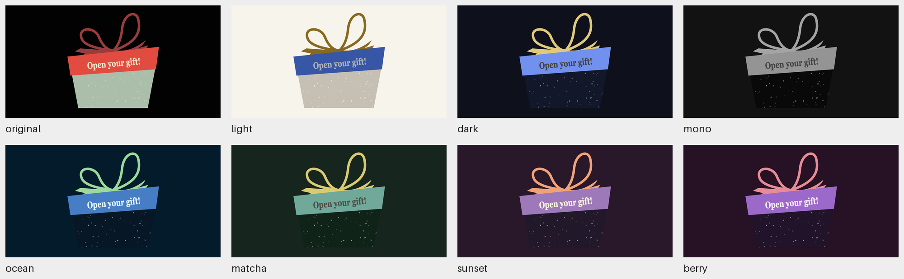

# Ribbon gift reveal

A red ribboned parcel opens into a pale card as dark New Year lettering springs into place.

| | |
| --- | --- |
| **Category** | [Seasonal › New Year](../) |
| **Size** | 576 × 301 CSS pixels, 2× export |
| **Colorways** | original, light, dark, mono, ocean, matcha, sunset, berry |
| **Fonts** | Georgia or the local serif fallback. |
| **Artwork** | Original procedural illustration and SVG geometry, drawn for Motherlode |
| **Animated** | Yes, 6.8-second loop |
| **Based on** | [A TikTok by @paulcodes4](https://www.tiktok.com/@paulcodes4/video/7695670579080285460) |

## Every colorway

## Files

- `source/design.html` is the standalone artwork. Its address accepts a palette such as `#matcha` and a preview time such as `?t=1.2#ocean`.
- `exports/` contains each palette’s PNG still and H.264 loop.

## Changing it

Click the parcel or press Enter to open the gift. The bow, folded lid, box and individual greeting letters have separate animation tracks. The colorway blocks at the top of the source define the inks and ground. Run `python3 .github/scripts/export_design.py seasonal/new-year/ribbon-gift-reveal` to regenerate the exports.
