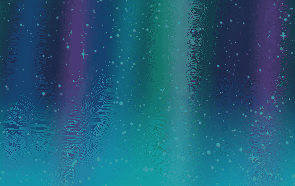
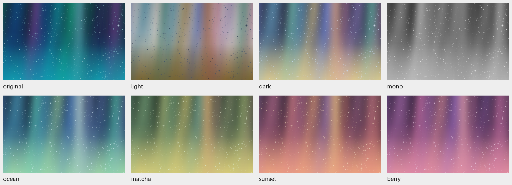

# Aurora snow curtains

Soft green and violet auroral curtains rise behind several depths of drifting snow.

| | |
| --- | --- |
| **Category** | [Seasonal › Winter](../) |
| **Size** | 576 × 365 CSS pixels, 2× export |
| **Colorways** | original, light, dark, mono, ocean, matcha, sunset, berry |
| **Fonts** | None. The artwork contains no lettering. |
| **Artwork** | Original procedural illustration and SVG geometry, drawn for Motherlode |
| **Animated** | Yes, 6.4-second loop |
| **Based on** | [A TikTok by @paulcodes4](https://www.tiktok.com/@paulcodes4/video/7696035855449771285) |

## Every colorway

## Files

- `source/design.html` is the standalone artwork. Its address accepts a palette such as `#matcha` and a preview time such as `?t=3.2#ocean`.
- `exports/` contains each palette’s PNG still and H.264 loop.

## Changing it

The long translucent color bands are independently drawn. Adjust snow count, depth and fall distance to change the weather. The colorway blocks at the top of the source define the inks and ground. Run `python3 .github/scripts/export_design.py seasonal/winter/aurora-snow-curtains` to regenerate the exports.
