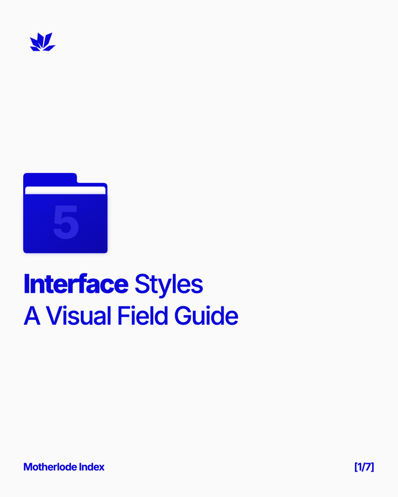
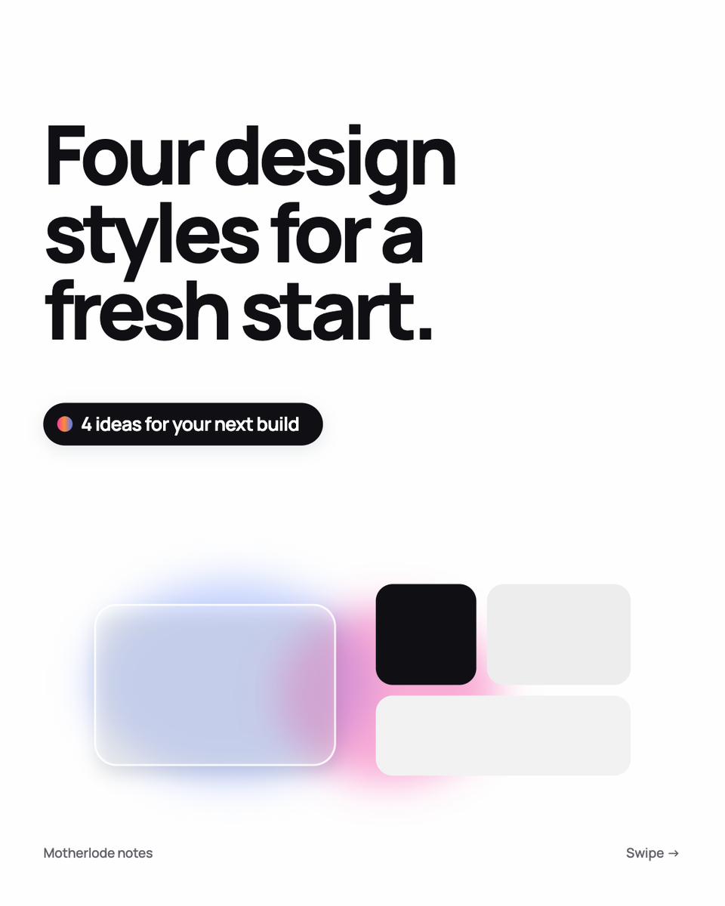
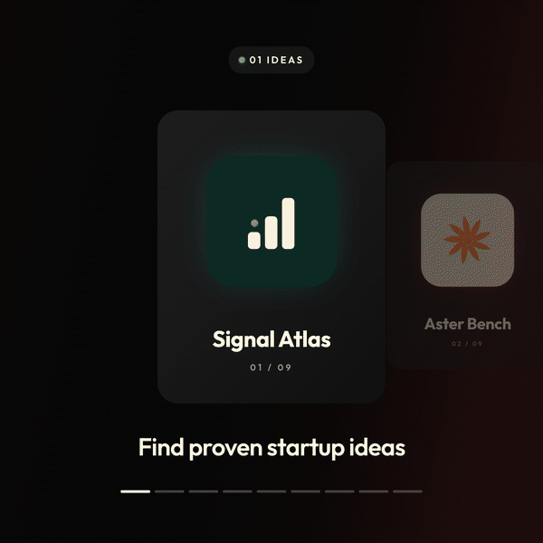

<!-- Generated by .github/scripts/build_catalog.py. Edit that file, not this one. -->
# Instagram carousels

Multi-slide carousels.

Part of [Social](../).

## Designs (3)

<table>
<tr><td align="center" valign="top" width="33%"> <a href="blue-interface-field-guide/"><b>Blue interface field guide</b></a> 8 colorways</td><td align="center" valign="top" width="33%"> <a href="four-design-directions/"><b>Four design directions</b></a> 8 colorways</td><td align="center" valign="top" width="33%"> <a href="midnight-solo-toolkit/"><b>Midnight solo toolkit</b></a> 8 colorways</td></tr>
</table>

Adding one? See [Adding a design](../../README.md#adding-a-design).
