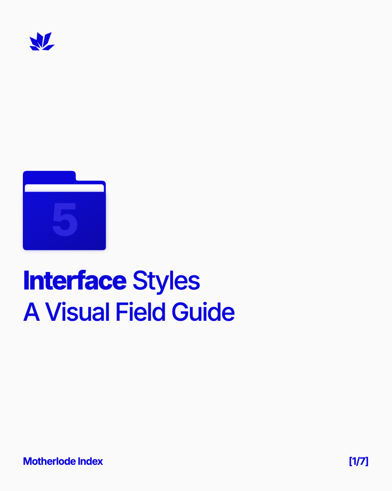
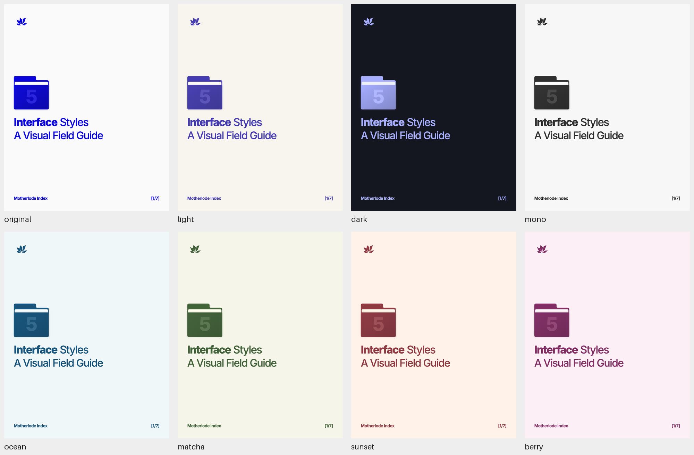

# Blue interface field guide

A seven-slide blue-and-white field guide pairs five interface styles with original miniature studies of dashboards, controls, portfolios and payments.

| | |
| --- | --- |
| **Category** | [Social › Instagram carousels](../) |
| **Size** | 1080 × 1350 per slide |
| **Slides** | 7 |
| **Colorways** | original, light, dark, mono, ocean, matcha, sunset, berry |
| **Font** | Inter, embedded with the SIL Open Font License in the HTML |
| **Artwork** | Original SVG illustrations and interface studies |
| **Animated** | No. Each slide is a still composition. |
| **Based on** | [A photo carousel by @designwithbyy](https://www.tiktok.com/@designwithbyy/photo/7682600099075099924) |

## Every colorway

## Slides

1. A visual field guide to five interface styles.
2. Glassmorphism. Translucent panels share an architectural scene, a landscape and a metrics board.
3. Neumorphism. Paired highlights and shadows shape soft, raised controls.
4. Neobrutalism. Outlines, saturated fills and offset shadows organize dense layouts.
5. Flat Design. Solid color blocks and clear type separate inputs, actions and results.
6. Minimalism. Large margins and a small set of type sizes organize three portfolios.
7. Keep the guide as a visual reference.

## Files

- Open [the standalone carousel](source/design.html) and use the left and right arrow keys, swipe horizontally, or use the buttons at either edge. Home and End jump to the cover and closing slide.
- Add `?slide=3#ocean` to the address to open the third slide in the ocean colorway. Slide numbers start at one.
- The [exports](exports/) include the eight cover PNGs. [Slide sets](exports/slides/) contain `01.png` through `07.png` in a folder for each colorway.

## Changing it

The palette blocks in `source/design.html` control the page and its illustrations. Edit the SVG group with the matching `data-slide` number to change a slide. Run `python3 .github/scripts/export_design.py social/instagram-carousels/blue-interface-field-guide` to rebuild every slide, the covers, preview and colorway sheet. Each slide also opens directly at its numbered address for export at 1080 × 1350.
