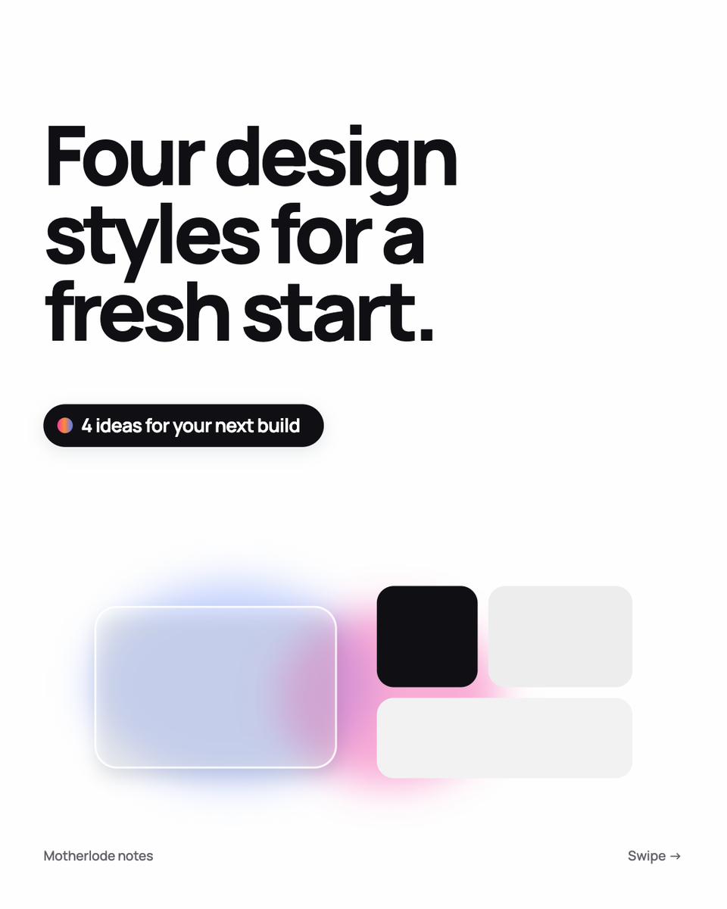
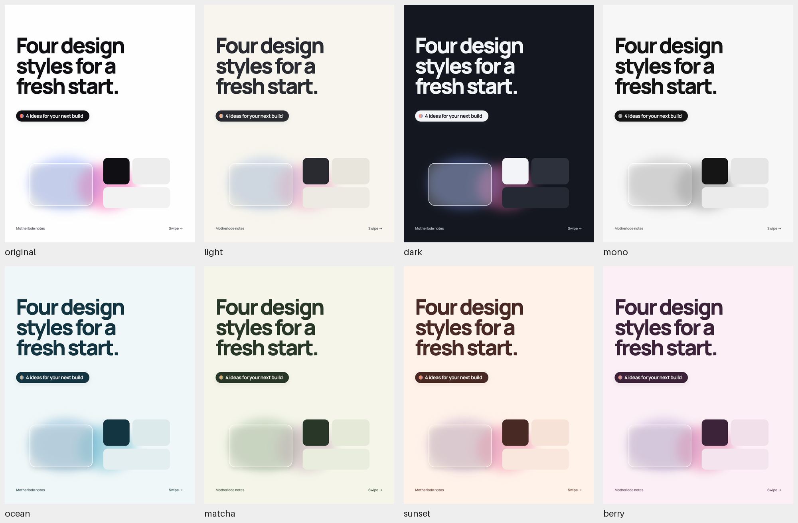

# Four design directions

Six editorial slides illustrate four design directions with a frosted card, a green bento layout, oversized lettering and a sculpted product interface.

| | |
| --- | --- |
| **Category** | [Social › Instagram carousels](../) |
| **Size** | 1080 × 1350 per slide |
| **Slides** | 6 |
| **Colorways** | original, light, dark, mono, ocean, matcha, sunset, berry |
| **Font** | Manrope, embedded with the SIL Open Font License in the HTML |
| **Artwork** | Original SVG illustrations and interface studies |
| **Animated** | No. Each slide is a still composition. |
| **Based on** | [A photo carousel by @brandlet_official](https://www.tiktok.com/@brandlet_official/photo/7701740057186651414) |

## Every colorway

## Slides

1. Four directions for a visual refresh.
2. Liquid glass. Translucency and bright edges lift a card off the page.
3. Bento grids. A modular grid organizes type, objects and images.
4. Giant type. A single oversized word anchors a poster.
5. Soft 3D. Cushioned forms and directional light give objects depth.
6. Choose one direction for the next project.

## Files

- Open [the standalone carousel](source/design.html) and use the left and right arrow keys, swipe horizontally, or use the buttons at either edge. Home and End jump to the cover and closing slide.
- Add `?slide=3#ocean` to the address to open the third slide in the ocean colorway. Slide numbers start at one.
- The [exports](exports/) include the eight cover PNGs. [Slide sets](exports/slides/) contain `01.png` through `06.png` in a folder for each colorway.

## Changing it

The palette blocks in `source/design.html` control the page and its illustrations. Edit the SVG group with the matching `data-slide` number to change a slide. Run `python3 .github/scripts/export_design.py social/instagram-carousels/four-design-directions` to rebuild every slide, the covers, preview and colorway sheet. Each slide also opens directly at its numbered address for export at 1080 × 1350.
