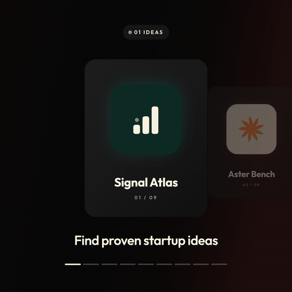
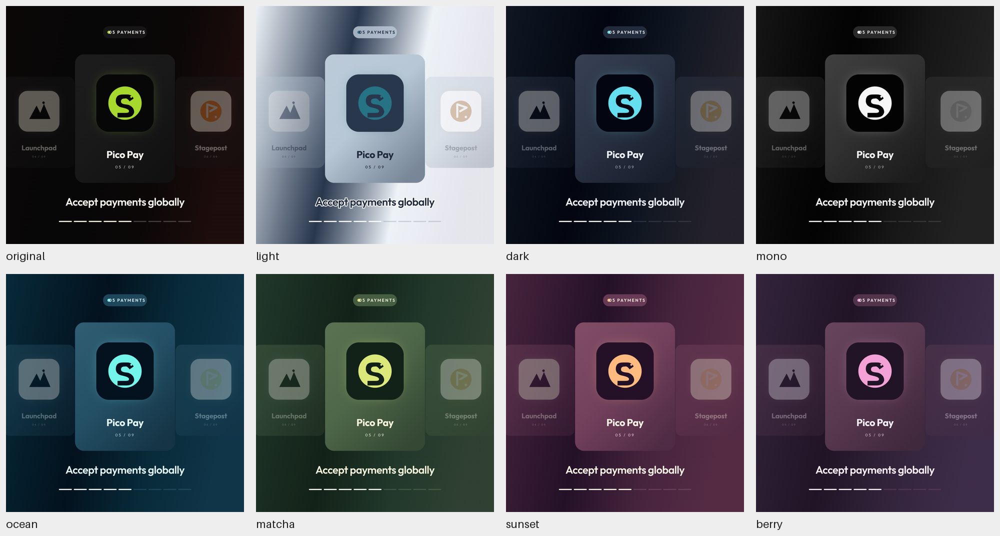

# Midnight solo toolkit

A square spotlight carousel follows nine fictional tools from idea research through payments, launch and growth. Each glowing icon scales into the center, its neighbors recede, and the sequence closes on a three-by-three grid.

| | |
| --- | --- |
| **Category** | [Social › Instagram carousels](../) |
| **Size** | 1080 × 1080 CSS pixels, exported at 1× |
| **Colorways** | original, light, dark, mono, ocean, matcha, sunset, berry |
| **Fonts** | Outfit, bundled under the SIL Open Font License |
| **Artwork** | Nine original SVG identities, custom pictograms, a dark card system and soft colored backlights. |
| **Animated** | Yes, 14.875-second loop at 24 fps |
| **Based on** | [A TikTok by @paulcodes4](https://www.tiktok.com/@paulcodes4/video/7696045900703075590) |

## Every colorway

## Files

- [Open the standalone design](source/design.html). Select either side or use the arrow keys to step through the deck. Select a tile in the closing grid to inspect that card. Space replays the full sequence.
- Add `#ocean` to switch palettes or `?t=6.68#ocean` to freeze the animation.
- [Exports](exports/) holds the colorway PNGs and H.264 loops.

The PNG slide set opens with the payments cover, followed by the eight other tools and the closing index. The video follows the original nine-stage sequence. Open `?slide=1` through `?slide=10` for individual states.

## Changing it

Edit the palette variables at the top of [the source](source/design.html), then run `python3 .github/scripts/export_design.py social/instagram-carousels/midnight-solo-toolkit` from the repository root.
