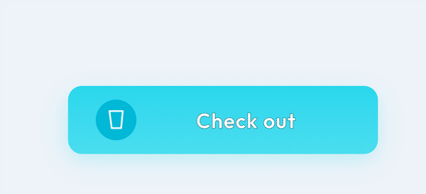
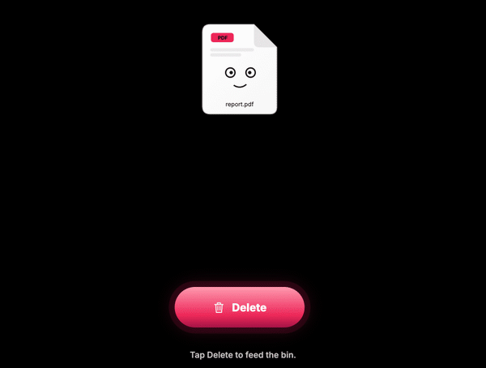
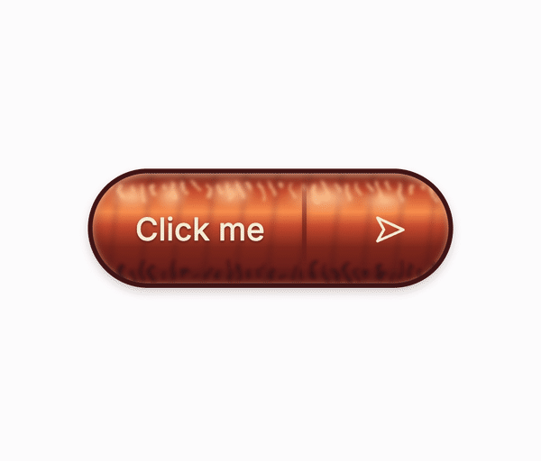
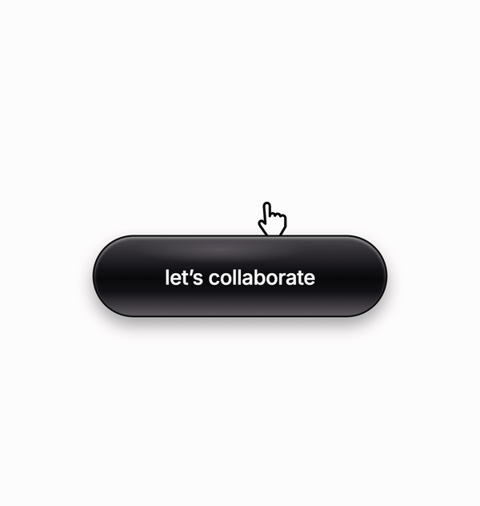
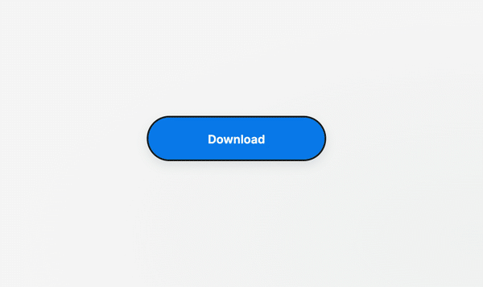
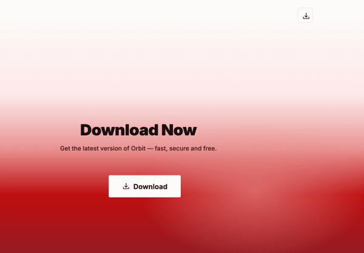
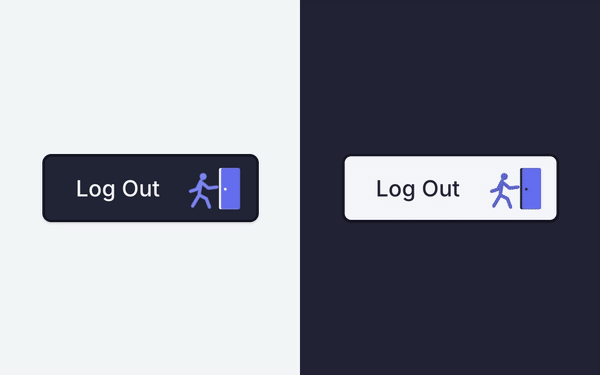

<!-- Generated by .github/scripts/build_catalog.py. Edit that file, not this one. -->
# Buttons

Buttons and their states.

Part of [UI](../).

## Designs (7)

<table>
<tr><td align="center" valign="top" width="33%"> <a href="aqua-drone-checkout/"><b>Aqua drone checkout</b></a> 8 colorways</td><td align="center" valign="top" width="33%"> <a href="cherry-bin-delete/"><b>Cherry bin delete button</b></a> 8 colorways</td><td align="center" valign="top" width="33%"> <a href="copper-foil-arrow/"><b>Copper foil arrow button</b></a> 8 colorways</td></tr>
<tr><td align="center" valign="top" width="33%"> <a href="ink-tendril-collaborate/"><b>Ink tendril collaborate button</b></a> 8 colorways</td><td align="center" valign="top" width="33%"> <a href="pixel-runner-download/"><b>Pixel runner download</b></a> 8 colorways</td><td align="center" valign="top" width="33%"> <a href="rocket-download/"><b>Rocket download</b></a> 8 colorways</td></tr>
<tr><td align="center" valign="top" width="33%"> <a href="walk-through-logout/"><b>Walk-through logout</b></a> 8 colorways</td></tr>
</table>

Adding one? See [Adding a design](../../README.md#adding-a-design).
