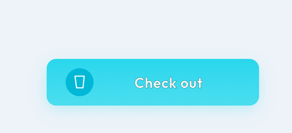
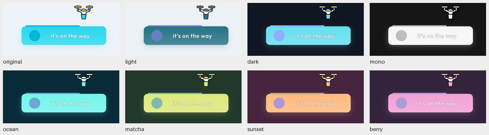

# Aqua drone checkout

A cyan checkout button dispatches a small yellow drone. It lifts a parcel, crosses the progress track, drops it off and returns a delivery confirmation.

| | |
| --- | --- |
| **Category** | [UI › Buttons](../) |
| **Size** | 576 × 262 CSS pixels, exported at 2× |
| **Colorways** | original, light, dark, mono, ocean, matcha, sunset, berry |
| **Fonts** | Outfit, bundled under the SIL Open Font License |
| **Artwork** | Original SVG drone, parcel, checkmark and delivery progress track. |
| **Animated** | Yes, 10.25-second loop at 24 fps |
| **Based on** | [A TikTok by @paulcodes4](https://www.tiktok.com/@paulcodes4/video/7694926591775870228) |

## Every colorway

## Files

- [Open the standalone design](source/design.html). Activate the checkout button to replay the delivery.
- Add `#ocean` to switch palettes or `?t=3.42#ocean` to freeze the animation.
- [Exports](exports/) holds the colorway PNGs and H.264 loops.

## Changing it

Edit the palette variables at the top of [the source](source/design.html), then run `python3 .github/scripts/export_design.py ui/buttons/aqua-drone-checkout` from the repository root.
