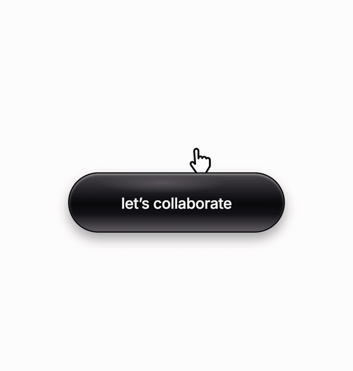
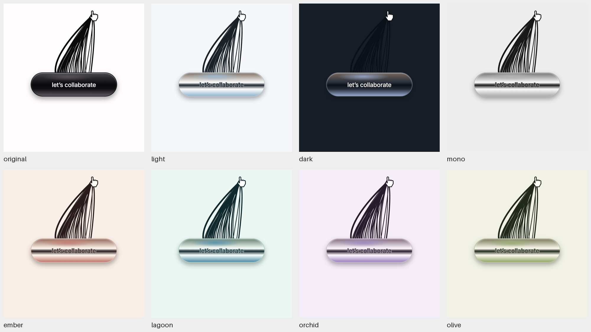

# Ink tendril collaborate button

Black strands grow out of a glossy collaboration pill and gather around the pointer. Fine droplets retract as the cursor moves back.

| | |
| --- | --- |
| **Category** | [UI › Buttons](../) |
| **Size** | 560 × 590 CSS pixels, exported at 2× |
| **Colorways** | original, light, dark, mono, ember, lagoon, orchid, olive |
| **Fonts** | Inter (bundled Latin subset from Google Fonts, SIL Open Font License) |
| **Icons** | Original inline SVG and CSS |
| **Animated** | Yes, 5.5-second loop at 24 fps |
| **Based on** | [A TikTok by @paulcodes4](https://www.tiktok.com/@paulcodes4/video/7700159238982716693) |

## Every colorway

## Files

- Open [the design](source/design.html) in a browser and append `#ember` to select that colorway. Add `?t=1.55#ember` after the filename to show the export still.
- [The exports folder](exports/) contains a PNG and an H.264 MP4 loop for each colorway.
- [The font folder](source/fonts/) includes the font files and their licenses.

## Changing it

Move the pointer above, below or alongside the pill to pull the ink strands toward it. Click the control or press Enter to replay the demonstrated movement.

The custom properties at the top of `source/design.html` define each palette. Copy a palette block, give it a new colorway name, then run `python3 .github/scripts/export_design.py ui/buttons/ink-tendril-collaborate` from the repository root.
