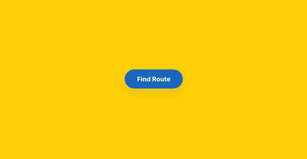
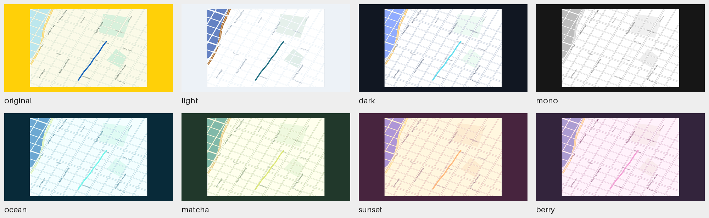

# Jigsaw route finder

A small blue route button sits on a yellow field. Map fragments assemble into a street grid, colored pins mark the endpoints, and a blue route draws between them.

| | |
| --- | --- |
| **Category** | [UI › Buttons](../) |
| **Size** | 576 × 300 CSS pixels, exported at 2× |
| **Colorways** | original, light, dark, mono, ocean, matcha, sunset, berry |
| **Fonts** | Inter, bundled under the SIL Open Font License |
| **Artwork** | Original fictional street map, jigsaw cutting paths and location pins. |
| **Animated** | Yes, 7.875-second loop at 24 fps |
| **Based on** | [A TikTok by @paulcodes4](https://www.tiktok.com/@paulcodes4/video/7694552740416048390) |

## Every colorway

## Files

- [Open the standalone design](source/design.html). Activate Find Route to assemble the map, or double-click the map to replay.
- Add `#ocean` to switch palettes or `?t=6.66#ocean` to freeze the animation.
- [Exports](exports/) holds the colorway PNGs and H.264 loops.

## Changing it

Edit the palette variables at the top of [the source](source/design.html), then run `python3 .github/scripts/export_design.py ui/buttons/jigsaw-route-finder` from the repository root.
