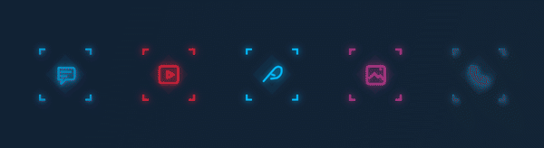
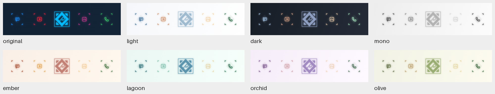

# Luminous contact icons

Five tiny contact glyphs sit between glowing corner marks. Hovering a glyph turns its corners into a bright square and diamond frame.

| | |
| --- | --- |
| **Category** | [UI › Buttons](../) |
| **Size** | 1032 × 282 CSS pixels, exported at 2× |
| **Colorways** | original, light, dark, mono, ember, lagoon, orchid, olive |
| **Fonts** | No lettering in the design |
| **Icons** | Original inline SVG and CSS |
| **Animated** | Yes, 6.6-second loop at 24 fps |
| **Based on** | [A TikTok by @paulcodes4](https://www.tiktok.com/@paulcodes4/video/7697527877486578965) |

## Every colorway

## Files

- Open [the design](source/design.html) in a browser and append `#ember` to select that colorway. Add `?t=3.7#ember` after the filename to show the export still.
- [The exports folder](exports/) contains a PNG and an H.264 MP4 loop for each colorway.

## Changing it

Hover or focus a glyph to expand the corresponding colored frame. Each icon is an original semantic symbol.

The custom properties at the top of `source/design.html` define each palette. Copy a palette block, give it a new colorway name, then run `python3 .github/scripts/export_design.py ui/buttons/luminous-contact-icons` from the repository root.
