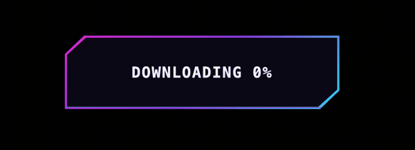
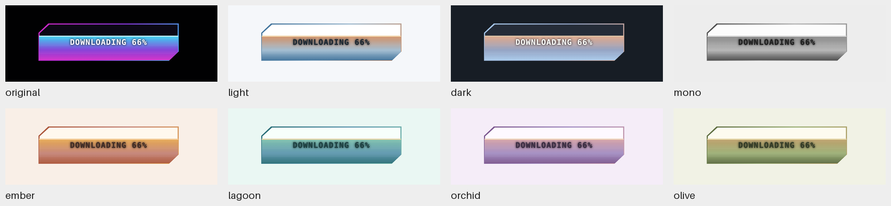

# Magenta scan download

Fine magenta scan lines and a cyan leading edge climb inside a clipped-corner download control. A monospaced percentage marks the progression.

| | |
| --- | --- |
| **Category** | [UI › Buttons](../) |
| **Size** | 768 × 278 CSS pixels, exported at 2× |
| **Colorways** | original, light, dark, mono, ember, lagoon, orchid, olive |
| **Fonts** | System monospace |
| **Icons** | Original inline SVG and CSS |
| **Animated** | Yes, 5.1-second loop at 24 fps |
| **Based on** | [A TikTok by @paulcodes4](https://www.tiktok.com/@paulcodes4/video/7696595223094381825) |

## Every colorway

## Files

- Open [the design](source/design.html) in a browser and append `#ember` to select that colorway. Add `?t=1.6#ember` after the filename to show the export still.
- [The exports folder](exports/) contains a PNG and an H.264 MP4 loop for each colorway.

## Changing it

Click or press Enter to replay. This is the angled wireframe control from the three-button demonstration.

The custom properties at the top of `source/design.html` define each palette. Copy a palette block, give it a new colorway name, then run `python3 .github/scripts/export_design.py ui/buttons/magenta-scan-download` from the repository root.
