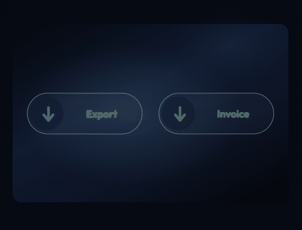
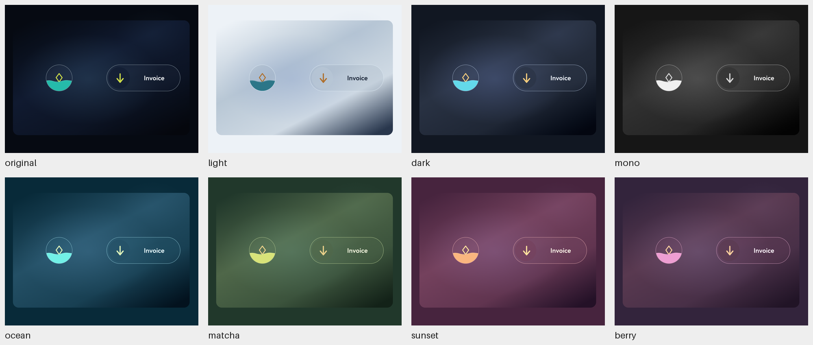

# Midnight liquid document actions

Two glass document actions share a dark blue panel. Each pill contracts around a diamond, fills with colored liquid, releases a droplet and expands to reveal its completed action.

| | |
| --- | --- |
| **Category** | [UI › Buttons](../) |
| **Size** | 576 × 440 CSS pixels, exported at 2× |
| **Colorways** | original, light, dark, mono, ocean, matcha, sunset, berry |
| **Fonts** | Outfit, bundled under the SIL Open Font License |
| **Artwork** | Original SVG glass panel, liquid animation, drops and arrow icons. |
| **Animated** | Yes, 8.5-second loop at 24 fps |
| **Based on** | [A TikTok by @paulcodes4](https://www.tiktok.com/@paulcodes4/video/7693445935501708565) |

## Every colorway

## Files

- [Open the standalone design](source/design.html). Activate Export or Invoice to run its independent progress animation. Select it again to replay.
- Add `#ocean` to switch palettes or `?t=1.5#ocean` to freeze the animation.
- [Exports](exports/) holds the colorway PNGs and H.264 loops.

## Changing it

Edit the palette variables at the top of [the source](source/design.html), then run `python3 .github/scripts/export_design.py ui/buttons/midnight-liquid-document-actions` from the repository root.
