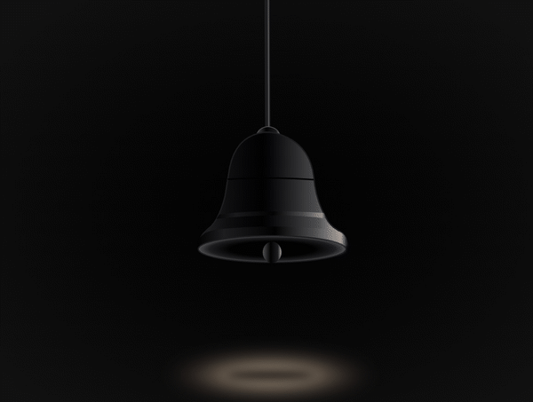
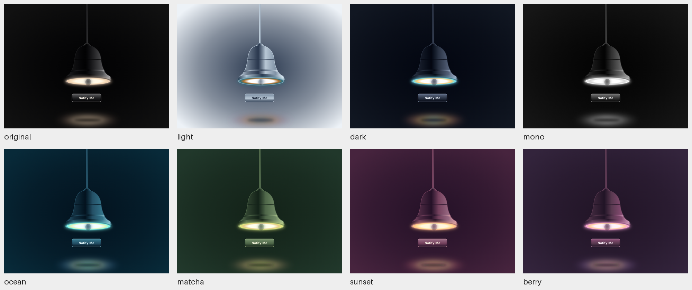

# Pendant notification bell

A polished black bell hangs from a thin cord. Warm light spreads under its lip and falls onto the floor as a metallic notification button appears.

| | |
| --- | --- |
| **Category** | [UI › Buttons](../) |
| **Size** | 576 × 435 CSS pixels, exported at 2× |
| **Colorways** | original, light, dark, mono, ocean, matcha, sunset, berry |
| **Fonts** | Inter, bundled under the SIL Open Font License |
| **Artwork** | Original SVG bell geometry, reflected metal gradients, clapper and cast light. |
| **Animated** | Yes, 5.125-second loop at 24 fps |
| **Based on** | [A TikTok by @paulcodes4](https://www.tiktok.com/@paulcodes4/video/7691223184376417557) |

## Every colorway

## Files

- [Open the standalone design](source/design.html). Select the bell or the notification button to switch the light.
- Add `#ocean` to switch palettes or `?t=2.5#ocean` to freeze the animation.
- [Exports](exports/) holds the colorway PNGs and H.264 loops.

## Changing it

Edit the palette variables at the top of [the source](source/design.html), then run `python3 .github/scripts/export_design.py ui/buttons/pendant-notification-bell` from the repository root.
