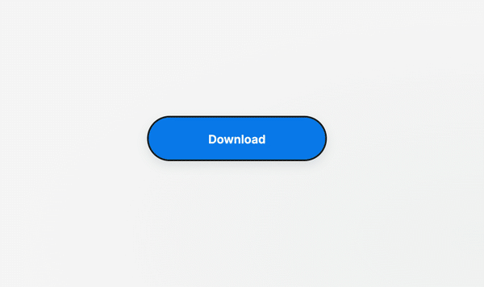
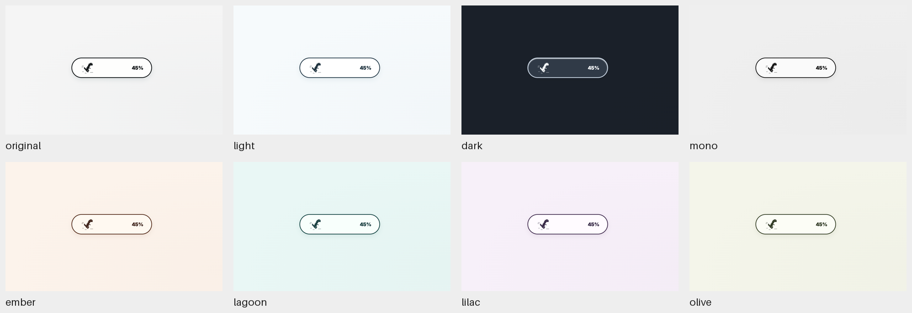

# Pixel runner download

A blue download pill opens into a white outlined track. A small pixel lizard runs beneath a progress counter before a green completion state appears.

| | |
| --- | --- |
| **Category** | [UI › Buttons](../) |
| **Size** | 864 × 513 CSS pixels, exported at 2× |
| **Colorways** | original, light, dark, mono, ember, lagoon, lilac, olive |
| **Fonts** | Inter (bundled Latin subset from Google Fonts, SIL Open Font License) |
| **Icons** | Original inline SVG and CSS |
| **Animated** | Yes, 5.2-second loop at 24 fps |
| **Based on** | [A TikTok by @paulcodes4](https://www.tiktok.com/@paulcodes4/video/7703833151205936404) |

## Every colorway

## Files

- Open [the design](source/design.html) in a browser and append `#ember` to select that colorway. Add `?t=2.5#ember` after the filename to show the export still.
- [The exports folder](exports/) contains a PNG and an H.264 MP4 loop for each colorway.
- [The font folder](source/fonts/) includes the font files and their licenses.

## Changing it

Press the pill to restart the download motion. The running animal is original pixel art with alternating footfalls, dust and speed marks.

The custom properties at the top of `source/design.html` define each palette. Copy a palette block, give it a new colorway name, then run `python3 .github/scripts/export_design.py ui/buttons/pixel-runner-download` from the repository root.
