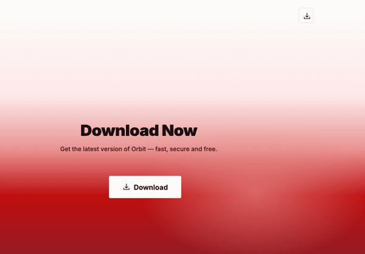
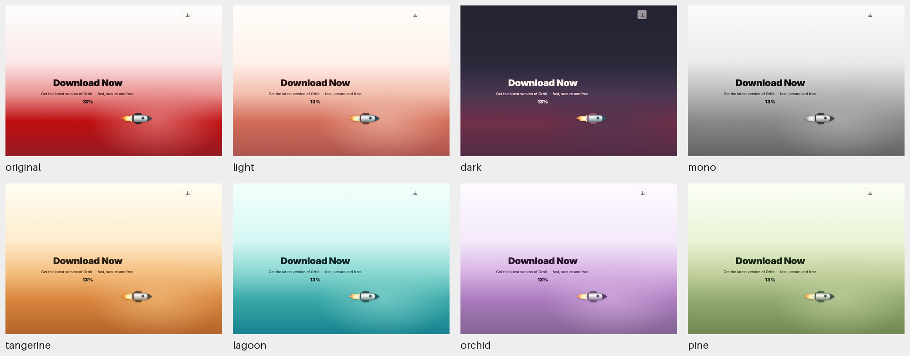

# Rocket download

A white download button launches a little metal rocket across a red-to-white canvas. The projectile arcs toward the download tray while the count climbs.

| | |
| --- | --- |
| **Category** | [UI › Buttons](../) |
| **Size** | 864 × 600 CSS pixels, exported at 2× |
| **Colorways** | original, light, dark, mono, tangerine, lagoon, orchid, pine |
| **Fonts** | Inter (bundled Latin subset from Google Fonts, SIL Open Font License) |
| **Icons** | Original inline SVG and CSS |
| **Animated** | Yes, 7.6-second loop at 24 fps |
| **Based on** | [A TikTok by @paulcodes4](https://www.tiktok.com/@paulcodes4/video/7704670215933578516) |

## Every colorway

## Files

- Open [the design](source/design.html) in a browser and append `#tangerine` to select that colorway. Add `?t=3#tangerine` after the filename to show the export still.
- [The exports folder](exports/) contains a PNG and an H.264 MP4 loop for each colorway.
- [The font folder](source/fonts/) includes the font files and their licenses.

## Changing it

Press Download to replay the launch. The rocket follows a curved path, turns nose-up and docks at the tray before a check appears.

The custom properties at the top of `source/design.html` define each palette. Copy a palette block, give it a new colorway name, then run `python3 .github/scripts/export_design.py ui/buttons/rocket-download` from the repository root.
