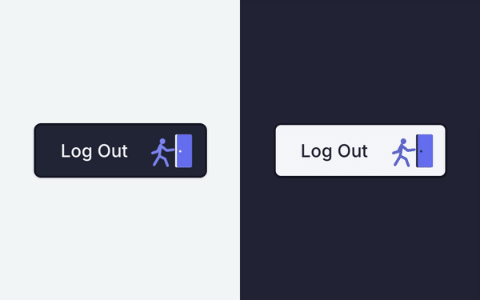
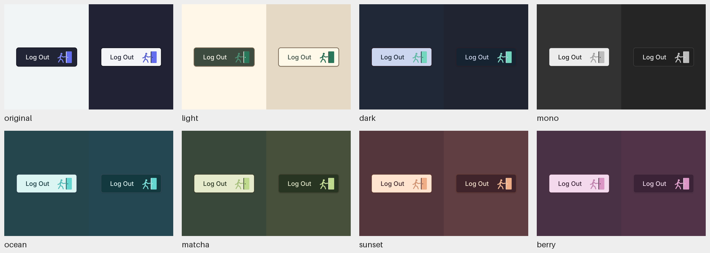

# Walk-through logout

Opposite light and dark buttons show a tiny person walking through a blue door. Each figure passes behind its swinging door. Three short strokes and a slight tilt mark the moment the door shuts.

| | |
| --- | --- |
| **Category** | [UI › Buttons](../) |
| **Size** | 538 × 336 CSS pixels, exported at 2× |
| **Colorways** | original, light, dark, mono, ocean, matcha, sunset, berry |
| **Fonts** | Inter, embedded under the SIL Open Font License. The HTML includes the license. |
| **Artwork** | Original SVG and CSS |
| **Animated** | Yes, 10.8-second loop at 24 fps |
| **Based on** | [A TikTok by @paulcodes4](https://www.tiktok.com/@paulcodes4/video/7693225104846703893) |

## Every colorway

## Files

- [Open the standalone design](source/design.html). Press either Log Out button to play its exit independently. The preview opens the left door at 3.76 seconds and the right at 8.10 seconds.
- Add `#ocean` to switch palettes or `?t=0.5#ocean` to freeze the preview.
- [Exports](exports/) contains a PNG and an H.264 MP4 for every colorway.

## Changing it

The CSS variables at the top of `source/design.html` control the palette. Copy a palette block, rename it, then run `python3 .github/scripts/export_design.py ui/buttons/walk-through-logout` from the repository root.
