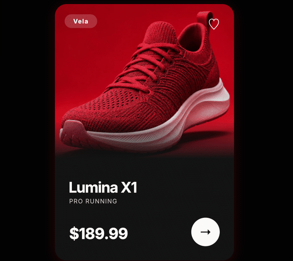
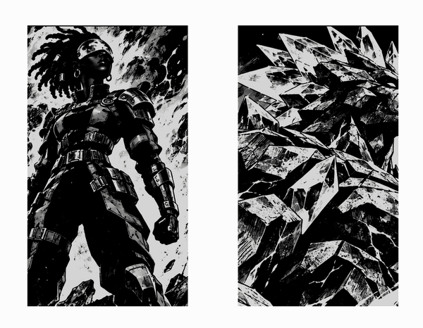
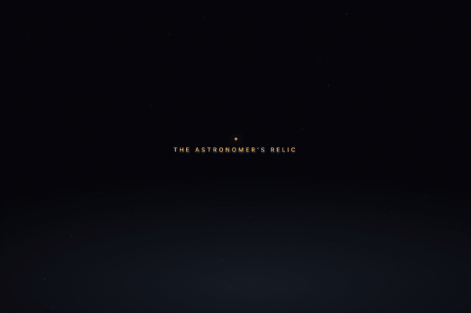
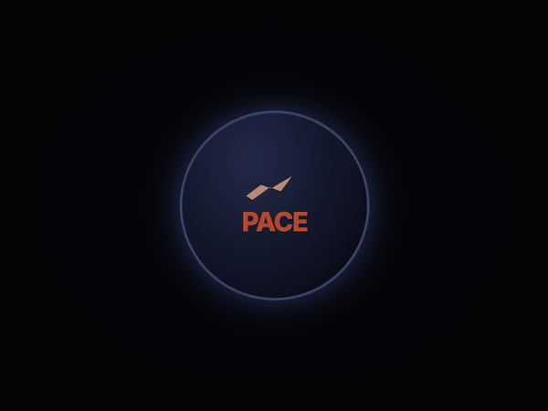
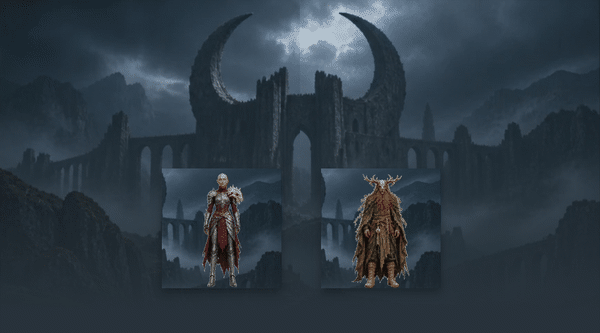
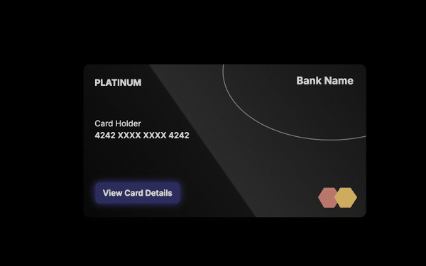
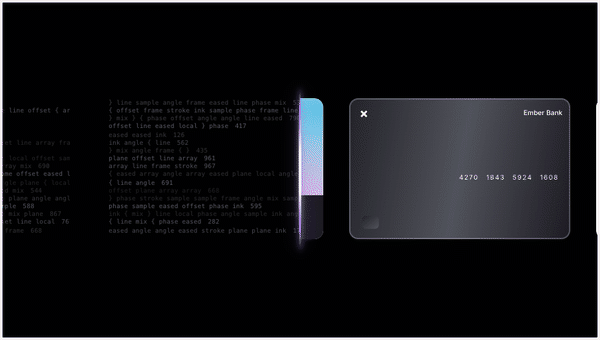
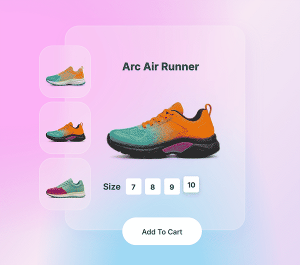

<!-- Generated by .github/scripts/build_catalog.py. Edit that file, not this one. -->
# Cards

Cards and tiles.

Part of [UI](../).

## Designs (9)

<table>
<tr><td align="center" valign="top" width="33%"> <a href="crimson-runner-detail/"><b>Crimson runner detail</b></a> 8 colorways</td><td align="center" valign="top" width="33%"> <a href="ember-and-jade-ink-reveal/"><b>Ember and jade ink reveal</b></a> 8 colorways</td><td align="center" valign="top" width="33%"> <a href="gilded-astronomer-relic/"><b>Gilded astronomer relic</b></a> 8 colorways</td></tr>
<tr><td align="center" valign="top" width="33%"> <a href="harbor-discovery-globe/"><b>Harbor discovery globe</b></a> 8 colorways</td><td align="center" valign="top" width="33%"> <a href="midnight-energy-can/"><b>Midnight energy can</b></a> 8 colorways</td><td align="center" valign="top" width="33%"> <a href="mistbound-guardian-pop-ups/"><b>Mistbound guardian pop-ups</b></a> 8 colorways</td></tr>
<tr><td align="center" valign="top" width="33%"> <a href="platinum-privacy-flip/"><b>Platinum privacy flip</b></a> 8 colorways</td><td align="center" valign="top" width="33%"> <a href="prism-beam-card-conveyor/"><b>Prism beam card conveyor</b></a> 8 colorways</td><td align="center" valign="top" width="33%"> <a href="prismatic-trainer-picker/"><b>Prismatic trainer picker</b></a> 8 colorways</td></tr>
</table>

Adding one? See [Adding a design](../../README.md#adding-a-design).
