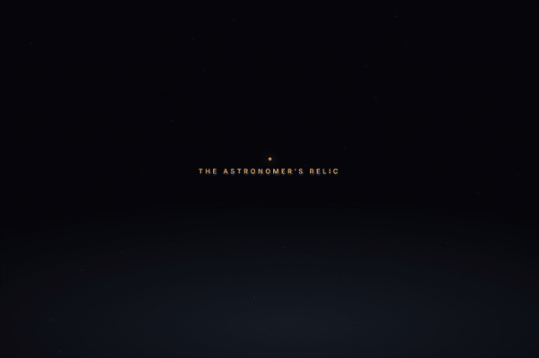
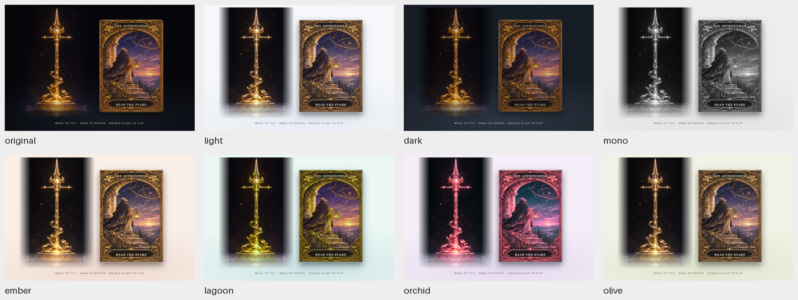

# Gilded astronomer relic

A golden ceremonial relic rises from an ember-lit plinth as an engraved fantasy card turns beside it. The card reveals an elaborate compass on its other face.

| | |
| --- | --- |
| **Category** | [UI › Cards](../) |
| **Size** | 992 × 660 CSS pixels, exported at 2× |
| **Colorways** | original, light, dark, mono, ember, lagoon, orchid, olive |
| **Fonts** | Inter (bundled Latin subset from Google Fonts, SIL Open Font License) |
| **Icons** | Original inline SVG and CSS |
| **Animated** | Yes, 7.8-second loop at 24 fps |
| **Based on** | [A TikTok by @paulcodes4](https://www.tiktok.com/@paulcodes4/video/7701611493225139476) |

## Every colorway

## Files

- Open [the design](source/design.html) in a browser and append `#ember` to select that colorway. Add `?t=2.6#ember` after the filename to show the export still.
- [The exports folder](exports/) contains a PNG and an H.264 MP4 loop for each colorway.
- [The font folder](source/fonts/) includes the font files and their licenses.

## Changing it

Move the pointer across the scene to tilt the card and shift the pedestal. Double-click, tap the card, or press Enter to turn it over. The ceremonial object, astronomer card and compass reverse are original AI-generated artwork.

The custom properties at the top of `source/design.html` define each palette. Copy a palette block, give it a new colorway name, then run `python3 .github/scripts/export_design.py ui/cards/gilded-astronomer-relic` from the repository root.
