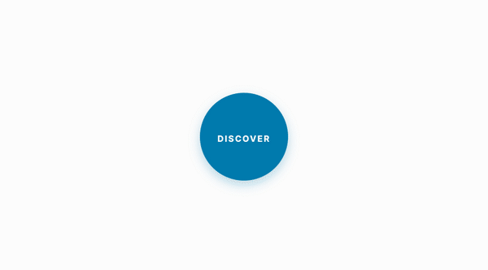
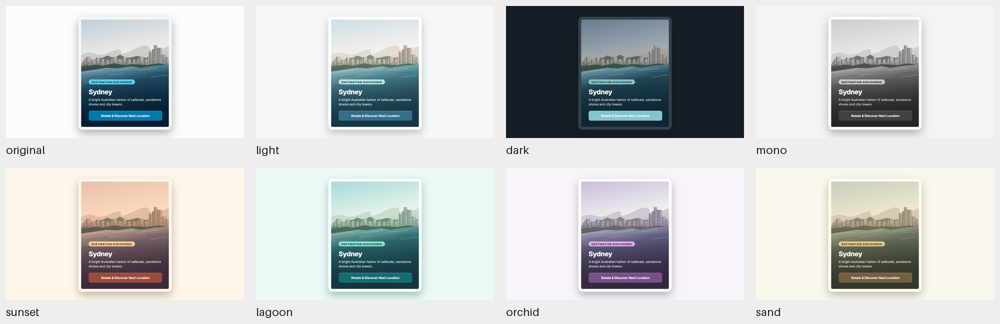

# Harbor discovery globe

A blue Discover button turns into a rotating globe and opens a harbor destination card. The illustrated card pairs a city view with a deep blue caption panel.

| | |
| --- | --- |
| **Category** | [UI › Cards](../) |
| **Size** | 864 × 480 CSS pixels, exported at 2× |
| **Colorways** | original, light, dark, mono, sunset, lagoon, orchid, sand |
| **Fonts** | Inter (bundled Latin subset from Google Fonts, SIL Open Font License) |
| **Icons** | Original inline SVG and CSS |
| **Animated** | Yes, 5.5-second loop at 24 fps |
| **Based on** | [A TikTok by @paulcodes4](https://www.tiktok.com/@paulcodes4/video/7703467354994248981) |

## Every colorway

## Files

- Open [the design](source/design.html) in a browser and append `#sunset` to select that colorway. Add `?t=5.03#sunset` after the filename to show the export still.
- [The exports folder](exports/) contains a PNG and an H.264 MP4 loop for each colorway.
- [The font folder](source/fonts/) includes the font files and their licenses.

## Changing it

Select Discover to turn the globe into a destination card. Use Explore another to replay the reveal. The harborside cityscape and map shapes are original vector artwork.

The custom properties at the top of `source/design.html` define each palette. Copy a palette block, give it a new colorway name, then run `python3 .github/scripts/export_design.py ui/cards/harbor-discovery-globe` from the repository root.
