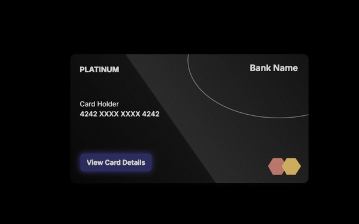
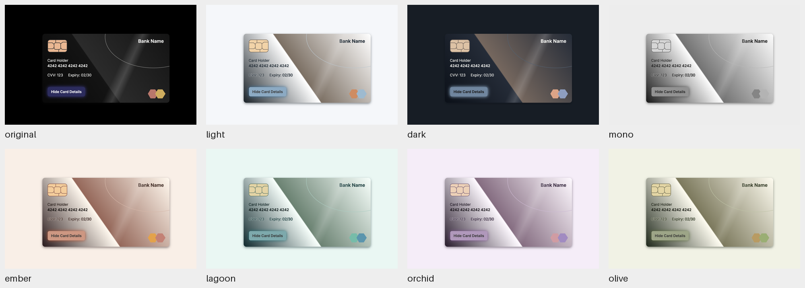

# Platinum privacy flip

Two low-contrast facets and a thin elliptical line mark a black platinum card. Its front turns to reveal a copper contact chip, security code and expiration.

| | |
| --- | --- |
| **Category** | [UI › Cards](../) |
| **Size** | 864 × 540 CSS pixels, exported at 2× |
| **Colorways** | original, light, dark, mono, ember, lagoon, orchid, olive |
| **Fonts** | Inter (bundled Latin subset from Google Fonts, SIL Open Font License) |
| **Icons** | Original inline SVG and CSS |
| **Animated** | Yes, 8-second loop at 24 fps |
| **Based on** | [A TikTok by @paulcodes4](https://www.tiktok.com/@paulcodes4/video/7693828576851938580) |

## Every colorway

## Files

- Open [the design](source/design.html) in a browser and append `#ember` to select that colorway. Add `?t=3.5#ember` after the filename to show the export still.
- [The exports folder](exports/) contains a PNG and an H.264 MP4 loop for each colorway.
- [The font folder](source/fonts/) includes the font files and their licenses.

## Changing it

Choose View Card Details or Hide Card Details to turn the card. Its account information is fictional and the payment mark is original.

The custom properties at the top of `source/design.html` define each palette. Copy a palette block, give it a new colorway name, then run `python3 .github/scripts/export_design.py ui/cards/platinum-privacy-flip` from the repository root.
