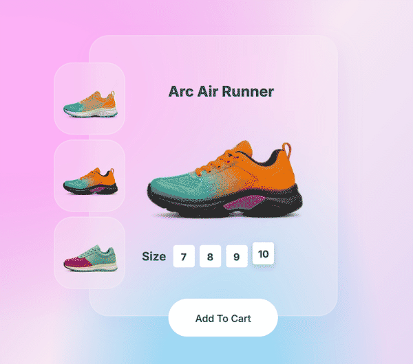
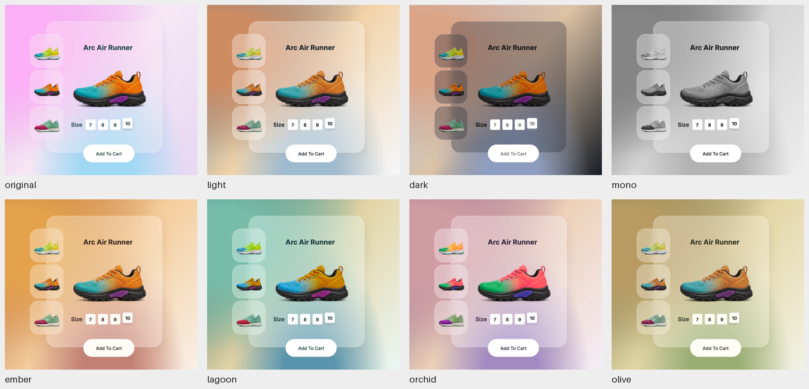

# Prismatic trainer picker

Three miniature shoes overlap the edge of a translucent product panel. Changing the selection swaps the sneaker, which rocks upward on hover against a pink and blue gradient.

| | |
| --- | --- |
| **Category** | [UI › Cards](../) |
| **Size** | 844 × 746 CSS pixels, exported at 2× |
| **Colorways** | original, light, dark, mono, ember, lagoon, orchid, olive |
| **Fonts** | Inter (bundled Latin subset from Google Fonts, SIL Open Font License) |
| **Icons** | Original inline SVG and CSS |
| **Animated** | Yes, 7.4-second loop at 24 fps |
| **Based on** | [A TikTok by @paulcodes4](https://www.tiktok.com/@paulcodes4/video/7697524528427076884) |

## Every colorway

## Files

- Open [the design](source/design.html) in a browser and append `#ember` to select that colorway. Add `?t=1#ember` after the filename to show the export still.
- [The exports folder](exports/) contains a PNG and an H.264 MP4 loop for each colorway.
- [The font folder](source/fonts/) includes the font files and their licenses.

## Changing it

Choose a shoe and size, hover the larger product to enlarge it or add the selection to the local cart. The three unbranded footwear studies are original generated product imagery.

The custom properties at the top of `source/design.html` define each palette. Copy a palette block, give it a new colorway name, then run `python3 .github/scripts/export_design.py ui/cards/prismatic-trainer-picker` from the repository root.
