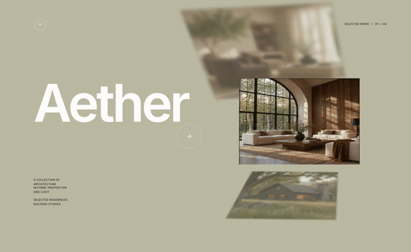
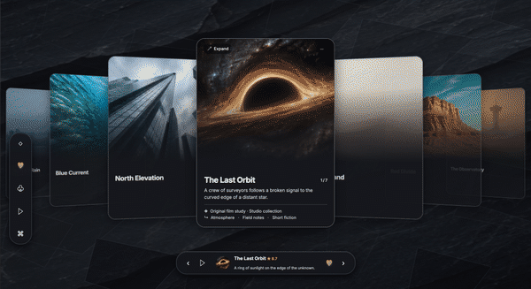
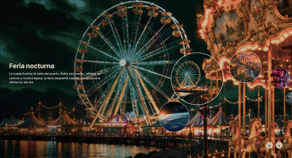

<!-- Generated by .github/scripts/build_catalog.py. Edit that file, not this one. -->
# Carousels

Carousels.

Part of [UI](../).

## Designs (4)

<table>
<tr><td align="center" valign="top" width="33%"> <a href="architectural-contact-reel/"><b>Architectural contact reel</b></a> 8 colorways</td><td align="center" valign="top" width="33%"> <a href="midnight-developer-card-ring/"><b>Midnight developer card ring</b></a> 8 colorways</td><td align="center" valign="top" width="33%"> <a href="obsidian-film-deck/"><b>Obsidian film deck</b></a> 8 colorways</td></tr>
<tr><td align="center" valign="top" width="33%"> <a href="orbiting-scene-carousel/"><b>Orbiting scene carousel</b></a> 8 colorways</td></tr>
</table>

Adding one? See [Adding a design](../../README.md#adding-a-design).
