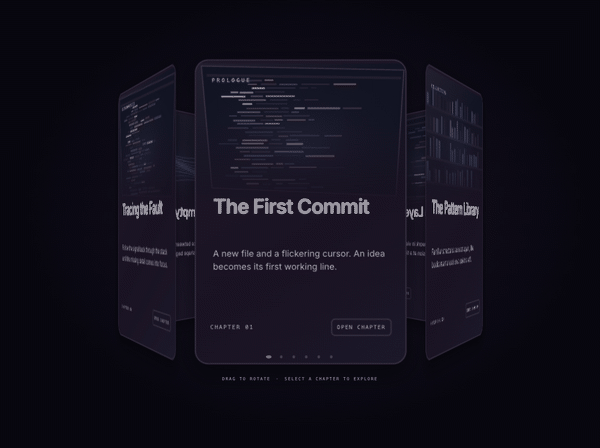
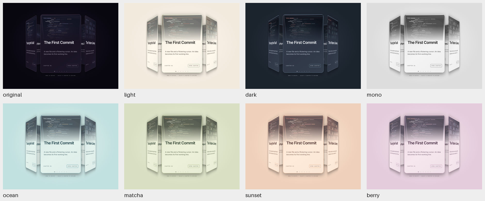

# Midnight developer card ring

Six translucent midnight cards rotate around a developer’s journal. Colored code marks, a library, a branching history and an orbital scene illustrate the chapters.

| | |
| --- | --- |
| **Category** | [UI › Carousels](../) |
| **Size** | 576 × 430 CSS pixels, exported at 2× |
| **Colorways** | original, light, dark, mono, ocean, matcha, sunset, berry |
| **Fonts** | Inter, embedded under the SIL Open Font License. The HTML includes the license. |
| **Artwork** | Original SVG and CSS |
| **Animated** | Yes, 14.4-second loop at 24 fps |
| **Based on** | [A TikTok by @paulcodes4](https://www.tiktok.com/@paulcodes4/video/7693077801787821332) |

## Every colorway

## Files

- [Open the standalone design](source/design.html). Drag or use the arrow keys and position dots. Each card opens a keyboard-accessible chapter dialog.
- Add `#ocean` to switch palettes or `?t=0.7#ocean` to freeze the preview.
- [Exports](exports/) contains a PNG and an H.264 MP4 for every colorway.

## Changing it

The CSS variables at the top of `source/design.html` control the palette. Copy a palette block, rename it, then run `python3 .github/scripts/export_design.py ui/carousels/midnight-developer-card-ring` from the repository root.
