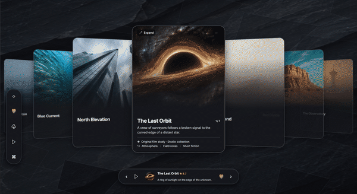
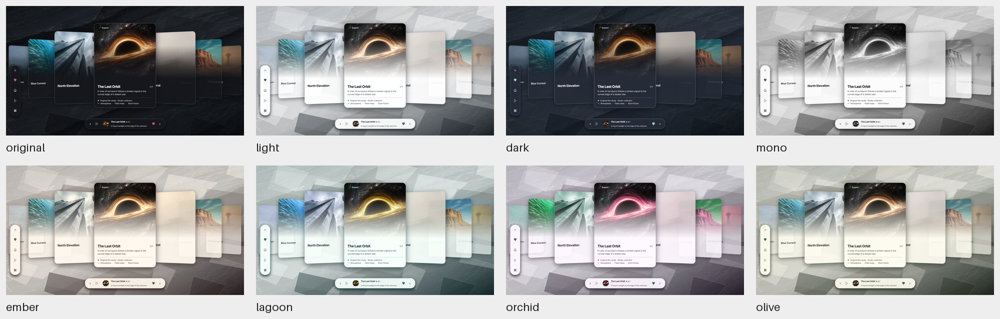

# Obsidian film deck

Seven original film studies fan across a dark fractured backdrop. The selected glass card expands into a synopsis while the other posters recede in perspective.

| | |
| --- | --- |
| **Category** | [UI › Carousels](../) |
| **Size** | 1152 × 628 CSS pixels, exported at 2× |
| **Colorways** | original, light, dark, mono, ember, lagoon, orchid, olive |
| **Fonts** | Inter (bundled Latin subset from Google Fonts, SIL Open Font License) |
| **Icons** | Original inline SVG and CSS |
| **Animated** | Yes, 5.6-second loop at 24 fps |
| **Based on** | [A TikTok by @paulcodes4](https://www.tiktok.com/@paulcodes4/video/7702716757777173780) |

## Every colorway

## Files

- Open [the design](source/design.html) in a browser and append `#ember` to select that colorway. Add `?t=0.18#ember` after the filename to show the export still.
- [The exports folder](exports/) contains a PNG and an H.264 MP4 loop for each colorway.
- [The font folder](source/fonts/) includes the font files and their licenses.

## Changing it

Use the previous and next controls or arrow keys to move through seven original illustrated stories. Select any poster to focus it, expand the current card with its top control, or save a favorite. The seven fictional film posters and slate texture share an original AI-generated photographic atlas.

The custom properties at the top of `source/design.html` define each palette. Copy a palette block, give it a new colorway name, then run `python3 .github/scripts/export_design.py ui/carousels/obsidian-film-deck` from the repository root.
