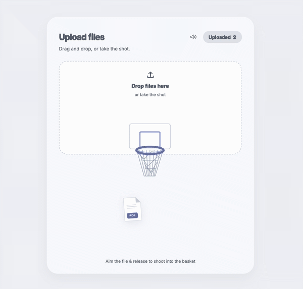
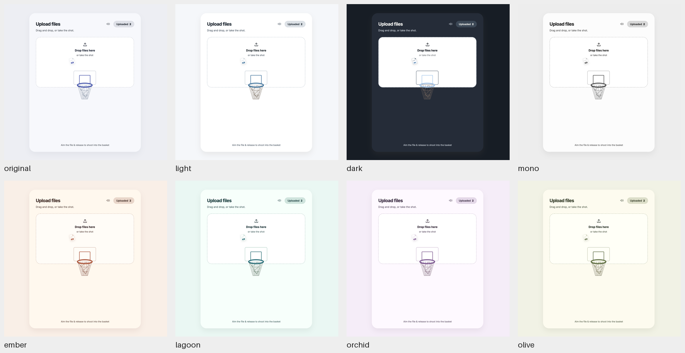

# Hoop shot upload

A paper file arcs through a miniature basketball net inside a file upload card. A transfer bar turns green and the upload count increments when the shot lands.

| | |
| --- | --- |
| **Category** | [UI › File uploads](../) |
| **Size** | 864 × 825 CSS pixels, exported at 2× |
| **Colorways** | original, light, dark, mono, ember, lagoon, orchid, olive |
| **Fonts** | Inter (bundled Latin subset from Google Fonts, SIL Open Font License) |
| **Icons** | Original inline SVG and CSS |
| **Animated** | Yes, 5.6-second loop at 24 fps |
| **Based on** | [A TikTok by @paulcodes4](https://www.tiktok.com/@paulcodes4/video/7701983203183070484) |

## Every colorway

## Files

- Open [the design](source/design.html) in a browser and append `#ember` to select that colorway. Add `?t=1.6#ember` after the filename to show the export still.
- [The exports folder](exports/) contains a PNG and an H.264 MP4 loop for each colorway.
- [The font folder](source/fonts/) includes the font files and their licenses.

## Changing it

Choose a local file or drag it onto the drop zone to shoot it toward the hoop. The status displays its name and size. All motion and completion feedback run locally.

The custom properties at the top of `source/design.html` define each palette. Copy a palette block, give it a new colorway name, then run `python3 .github/scripts/export_design.py ui/file-uploads/hoop-shot-upload` from the repository root.
