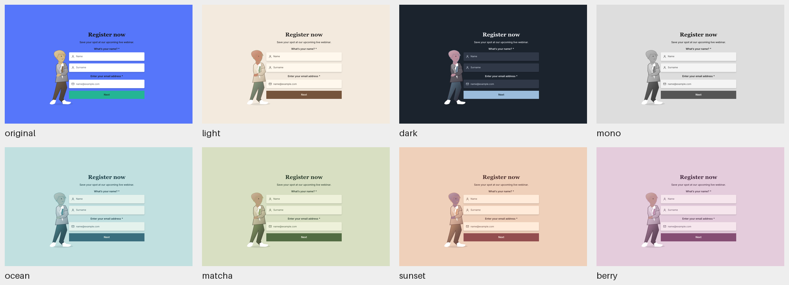

# Briefcase webinar registration

A presenter sets down a briefcase on a cornflower-blue stage. A webinar registration form then unfolds above it. The presenter is an original vector illustration.

| | |
| --- | --- |
| **Category** | [UI › Forms](../) |
| **Size** | 508 × 322 CSS pixels, exported at 2× |
| **Colorways** | original, light, dark, mono, ocean, matcha, sunset, berry |
| **Fonts** | Inter with a Georgia serif headline. Inter is embedded under the SIL Open Font License. |
| **Artwork** | Original SVG and CSS |
| **Animated** | Yes, 6.2-second loop at 24 fps |
| **Based on** | [A TikTok by @paulcodes4](https://www.tiktok.com/@paulcodes4/video/7697155903455317268) |

## Every colorway

## Files

- [Open the standalone design](source/design.html). Enter a first name, surname and email address and choose Next to complete the local demonstration.
- Add `#ocean` to switch palettes or `?t=4.3#ocean` to freeze the preview.
- [Exports](exports/) contains a PNG and an H.264 MP4 for every colorway.

## Changing it

The CSS variables at the top of `source/design.html` control the palette. Copy a palette block, rename it, then run `python3 .github/scripts/export_design.py ui/forms/briefcase-webinar-registration` from the repository root.
