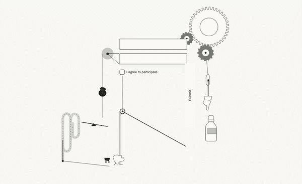
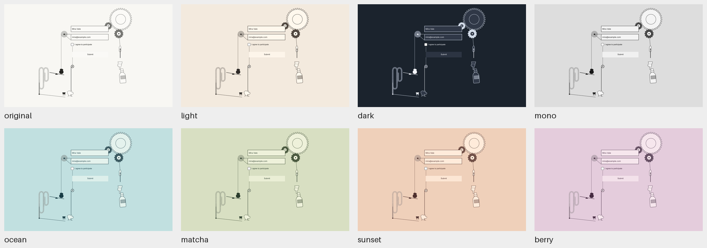

# Clockwork registration form

A small registration form operates a hand-drawn Rube Goldberg machine. Geared wheels, a suspended weight, tubing and a pivoting lever reveal the submit control.

| | |
| --- | --- |
| **Category** | [UI › Forms](../) |
| **Size** | 576 × 352 CSS pixels, exported at 2× |
| **Colorways** | original, light, dark, mono, ocean, matcha, sunset, berry |
| **Fonts** | Arial with a generic sans-serif fallback for the mechanical form’s small labels. |
| **Artwork** | Original SVG and CSS |
| **Animated** | Yes, 6-second loop at 24 fps |
| **Based on** | [A TikTok by @paulcodes4](https://www.tiktok.com/@paulcodes4/video/7693075942238932244) |

## Every colorway

## Files

- [Open the standalone design](source/design.html). Fill in your name and email, then check the consent box to rotate the submit button into place.
- Add `#ocean` to switch palettes or `?t=4.57#ocean` to freeze the preview.
- [Exports](exports/) contains a PNG and an H.264 MP4 for every colorway.

## Changing it

The CSS variables at the top of `source/design.html` control the palette. Copy a palette block, rename it, then run `python3 .github/scripts/export_design.py ui/forms/clockwork-registration-form` from the repository root.
