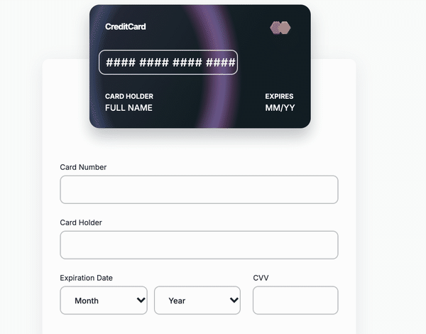
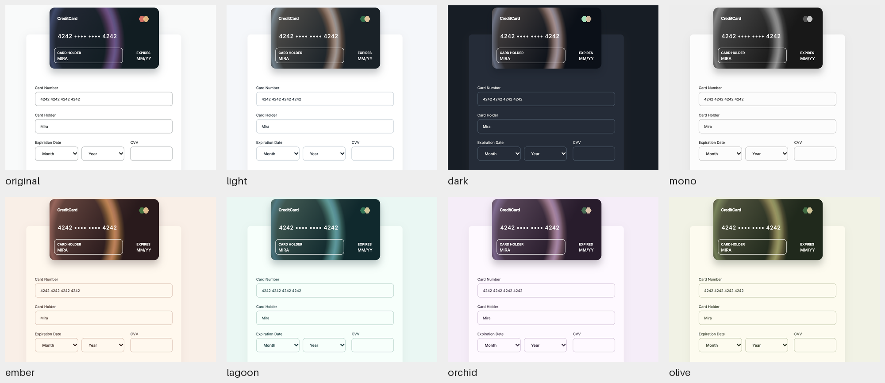

# Violet arc card form

A dark payment card floats over a white form. A violet reflection curves around its face as the active field is framed and the card turns over for the security code.

| | |
| --- | --- |
| **Category** | [UI › Forms](../) |
| **Size** | 924 × 724 CSS pixels, exported at 2× |
| **Colorways** | original, light, dark, mono, ember, lagoon, orchid, olive |
| **Fonts** | Inter (bundled Latin subset from Google Fonts, SIL Open Font License) |
| **Icons** | Original inline SVG and CSS |
| **Animated** | Yes, 12-second loop at 24 fps |
| **Based on** | [A TikTok by @paulcodes4](https://www.tiktok.com/@paulcodes4/video/7698721716628966677) |

## Every colorway

## Files

- Open [the design](source/design.html) in a browser and append `#ember` to select that colorway. Add `?t=3.5#ember` after the filename to show the export still.
- [The exports folder](exports/) contains a PNG and an H.264 MP4 loop for each colorway.
- [The font folder](source/fonts/) includes the font files and their licenses.

## Changing it

Type sample details, select an expiry month and year, and focus the security code to turn the card over. Values stay in the browser. The card mark and light reflections are original.

The custom properties at the top of `source/design.html` define each palette. Copy a palette block, give it a new colorway name, then run `python3 .github/scripts/export_design.py ui/forms/violet-arc-card-form` from the repository root.
