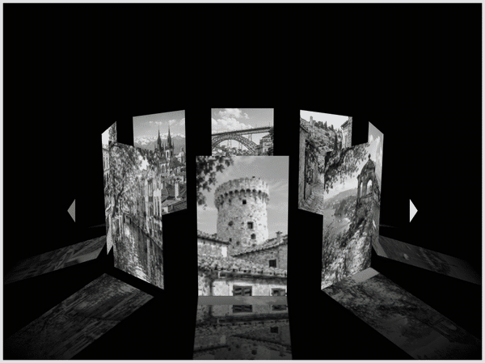
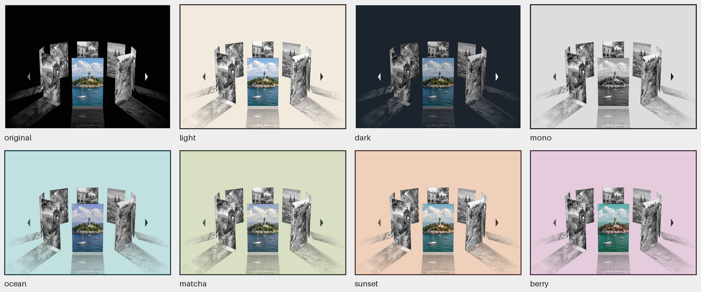

# Monochrome travel ring

Portrait travel photographs stand around a black reflective floor. The selected print shifts into color as the ring turns.

| | |
| --- | --- |
| **Category** | [UI › Galleries](../) |
| **Size** | 490 × 367 CSS pixels, exported at 2× |
| **Colorways** | original, light, dark, mono, ocean, matcha, sunset, berry |
| **Fonts** | Inter, embedded under the SIL Open Font License. The HTML includes the license. |
| **Artwork** | Original SVG and CSS |
| **Animated** | Yes, 12.8-second loop at 24 fps |
| **Based on** | [A TikTok by @paulcodes4](https://www.tiktok.com/@paulcodes4/video/7694361859075378453) |

## Every colorway

## Files

- [Open the standalone design](source/design.html). Use either arrow or drag the ring to choose a photograph. Focusing the gallery enables keyboard navigation.
- Add `#ocean` to switch palettes or `?t=3.57#ocean` to freeze the preview.
- [Exports](exports/) contains a PNG and an H.264 MP4 for every colorway.

The eight travel scenes are original images generated for this design with the built-in imagegen tool. The artwork is packed into `source/original-travel-atlas.webp`.

## Changing it

The CSS variables at the top of `source/design.html` control the palette. Copy a palette block, rename it, then run `python3 .github/scripts/export_design.py ui/galleries/monochrome-travel-ring` from the repository root.
