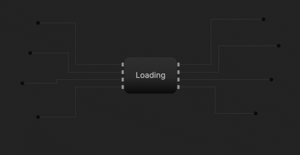

<!-- Generated by .github/scripts/build_catalog.py. Edit that file, not this one. -->
# Loaders

Spinners and loading indicators.

Part of [UI](../).

## Designs (4)

<table>
<tr><td align="center" valign="top" width="33%"> <a href="aqua-orbiting-beads/"><b>Aqua orbiting beads</b></a> 8 colorways</td><td align="center" valign="top" width="33%"> <a href="eclipse-iris-pair/"><b>Eclipse iris loader</b></a> 8 colorways</td><td align="center" valign="top" width="33%"> <a href="eight-trace-loading-chip/"><b>Eight-trace loading chip</b></a> 8 colorways</td></tr>
<tr><td align="center" valign="top" width="33%"> <a href="rose-filament-torus/"><b>Rose filament torus</b></a> 8 colorways</td></tr>
</table>

Adding one? See [Adding a design](../../README.md#adding-a-design).
