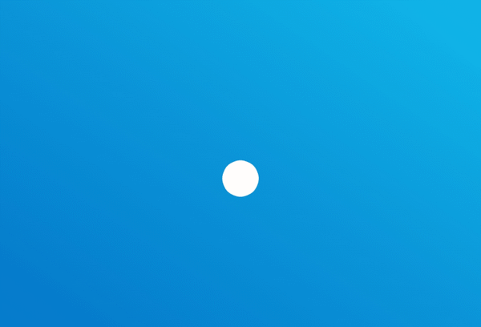
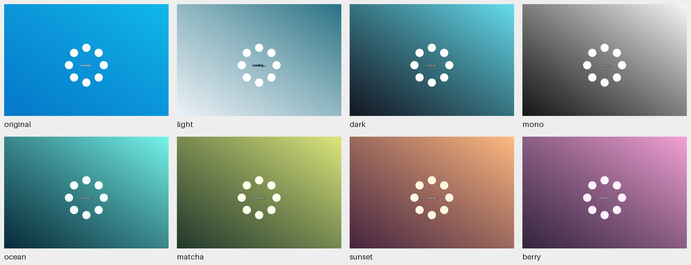

# Aqua orbiting beads

Eight white beads spread from a compact cluster into a ring around a loading label, hold briefly and fold back together across a blue gradient.

| | |
| --- | --- |
| **Category** | [UI › Loaders](../) |
| **Size** | 576 × 392 CSS pixels, exported at 2× |
| **Colorways** | original, light, dark, mono, ocean, matcha, sunset, berry |
| **Fonts** | Inter, bundled under the SIL Open Font License |
| **Artwork** | Original SVG bead geometry and staggered orbital keyframes. |
| **Animated** | Yes, 4.75-second loop at 24 fps |
| **Based on** | [A TikTok by @paulcodes4](https://www.tiktok.com/@paulcodes4/video/7695669143848226049) |

## Every colorway

## Files

- [Open the standalone design](source/design.html). Select the scene to replay the loop.
- Add `#ocean` to switch palettes or `?t=2#ocean` to freeze the animation.
- [Exports](exports/) holds the colorway PNGs and H.264 loops.

## Changing it

Edit the palette variables at the top of [the source](source/design.html), then run `python3 .github/scripts/export_design.py ui/loaders/aqua-orbiting-beads` from the repository root.
