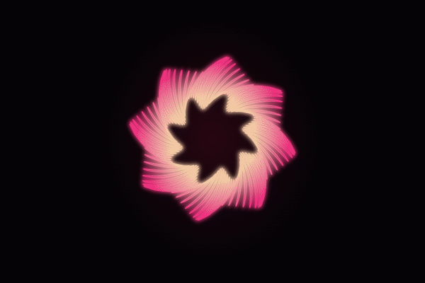
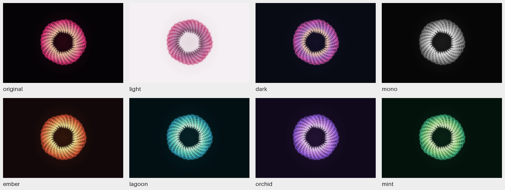

# Rose filament torus

An illuminated ring changes from eight swept petals to a fine woven torus. Its inner fibers glow peach while the outer edge burns pink against black.

| | |
| --- | --- |
| **Category** | [UI › Loaders](../) |
| **Size** | 864 × 576 CSS pixels, exported at 2× |
| **Colorways** | original, light, dark, mono, ember, lagoon, orchid, mint |
| **Fonts** | No lettering in the design |
| **Icons** | Original inline SVG and CSS |
| **Animated** | Yes, 8-second loop at 24 fps |
| **Based on** | [A TikTok by @paulcodes4](https://www.tiktok.com/@paulcodes4/video/7706428288138333460) |

## Every colorway

## Files

- Open [the design](source/design.html) in a browser and append `#ember` to select that colorway. Add `?t=3#ember` after the filename to show the export still.
- [The exports folder](exports/) contains a PNG and an H.264 MP4 loop for each colorway.

## Changing it

The animated paths use a sampled toroidal projection. The changing twist and phase create the wire mesh, broad petal outlines and continuous rotation seen in the video. Click to pause or resume.

The custom properties at the top of `source/design.html` define each palette. Copy a palette block, give it a new colorway name, then run `python3 .github/scripts/export_design.py ui/loaders/rose-filament-torus` from the repository root.
