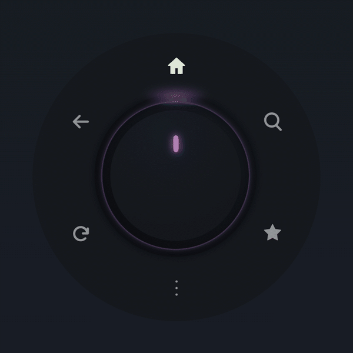
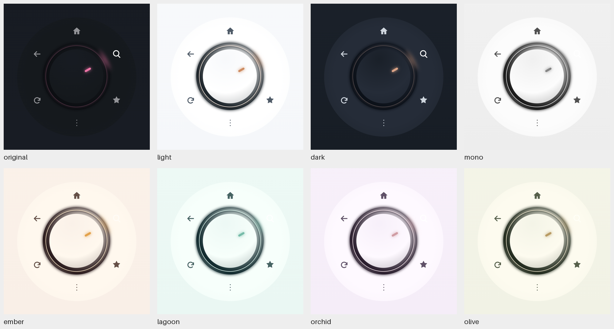

# Midnight index dial

Six glyphs surround a dark rotary selector. Its luminous short hand locks to the selected command, changing the color and position of the outer glow.

| | |
| --- | --- |
| **Category** | [UI › Menus](../) |
| **Size** | 864 × 864 CSS pixels, exported at 2× |
| **Colorways** | original, light, dark, mono, ember, lagoon, orchid, olive |
| **Fonts** | No lettering in the design |
| **Icons** | Original inline SVG and CSS |
| **Animated** | Yes, 7.2-second loop at 24 fps |
| **Based on** | [A TikTok by @paulcodes4](https://www.tiktok.com/@paulcodes4/video/7693954680350674197) |

## Every colorway

## Files

- Open [the design](source/design.html) in a browser and append `#ember` to select that colorway. Add `?t=3.4#ember` after the filename to show the export still.
- [The exports folder](exports/) contains a PNG and an H.264 MP4 loop for each colorway.

## Changing it

Open the selector with its center, then select an icon. The arrow keys cycle through the six positions and Escape closes them.

The custom properties at the top of `source/design.html` define each palette. Copy a palette block, give it a new colorway name, then run `python3 .github/scripts/export_design.py ui/menus/midnight-index-dial` from the repository root.
