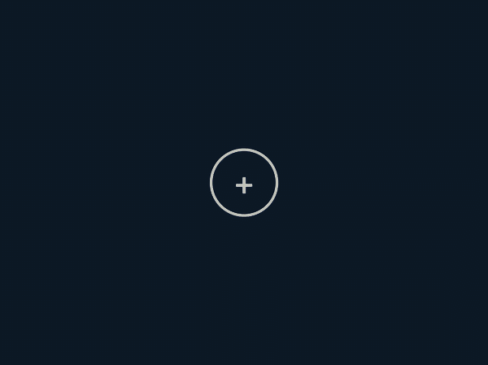
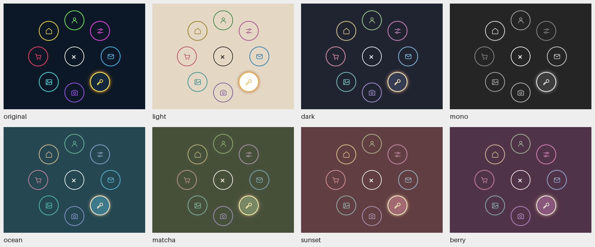

# Neon orbit menu

Eight colored action buttons radiate around a rotating plus. Each icon lights up independently on hover or selection.

| | |
| --- | --- |
| **Category** | [UI › Menus](../) |
| **Size** | 430 × 322 CSS pixels, exported at 2× |
| **Colorways** | original, light, dark, mono, ocean, matcha, sunset, berry |
| **Fonts** | Inter, embedded under the SIL Open Font License. The HTML includes the license. |
| **Artwork** | Original SVG and CSS |
| **Animated** | Yes, 5.3-second loop at 24 fps |
| **Based on** | [A TikTok by @paulcodes4](https://www.tiktok.com/@paulcodes4/video/7696963592867810581) |

## Every colorway

## Files

- [Open the standalone design](source/design.html). Open the menu with the center button, then choose any of the eight actions.
- Add `#ocean` to switch palettes or `?t=2.03#ocean` to freeze the preview.
- [Exports](exports/) contains a PNG and an H.264 MP4 for every colorway.

## Changing it

The CSS variables at the top of `source/design.html` control the palette. Copy a palette block, rename it, then run `python3 .github/scripts/export_design.py ui/menus/neon-orbit-menu` from the repository root.
