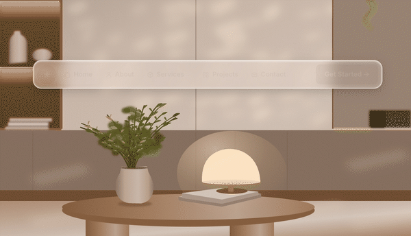

<!-- Generated by .github/scripts/build_catalog.py. Edit that file, not this one. -->
# Navbars

Top navigation bars.

Part of [UI](../).

## Designs (1)

<table>
<tr><td align="center" valign="top" width="33%"> <a href="sunlit-services-megamenu/"><b>Sunlit services megamenu</b></a> 8 colorways</td></tr>
</table>

Adding one? See [Adding a design](../../README.md#adding-a-design).
