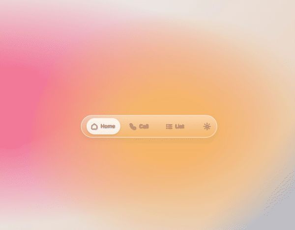
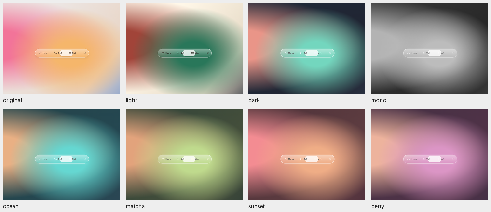

# Apricot liquid navbar

A shallow glass navbar floats over a peach, pink and periwinkle gradient. A pale capsule glides between three labeled destinations.

| | |
| --- | --- |
| **Category** | [UI › Navbars](../) |
| **Size** | 576 × 450 CSS pixels, exported at 2× |
| **Colorways** | original, light, dark, mono, ocean, matcha, sunset, berry |
| **Fonts** | Inter, embedded under the SIL Open Font License. The HTML includes the license. |
| **Artwork** | Original SVG and CSS |
| **Animated** | Yes, 4.5-second loop at 24 fps |
| **Based on** | [A TikTok by @paulcodes4](https://www.tiktok.com/@paulcodes4/video/7691956534250589461) |

## Every colorway

## Files

- [Open the standalone design](source/design.html). Select any destination or use the arrow keys to move the indicator. Use the sun to switch the lighting.
- Add `#ocean` to switch palettes or `?t=2.15#ocean` to freeze the preview.
- [Exports](exports/) contains a PNG and an H.264 MP4 for every colorway.

## Changing it

The CSS variables at the top of `source/design.html` control the palette. Copy a palette block, rename it, then run `python3 .github/scripts/export_design.py ui/navbars/apricot-liquid-navbar` from the repository root.
