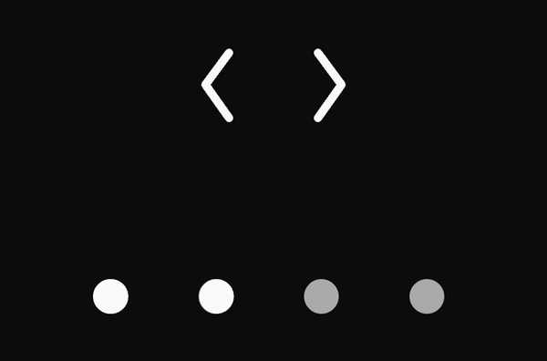
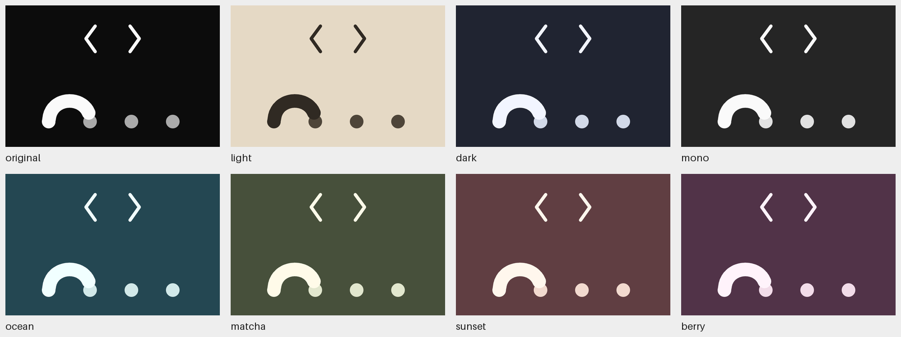

# Spring arc pagination

A thick white spring rolls over four gray page dots. Two slender chevrons advance or reverse the arc.

| | |
| --- | --- |
| **Category** | [UI › Pagination](../) |
| **Size** | 394 × 260 CSS pixels, exported at 2× |
| **Colorways** | original, light, dark, mono, ocean, matcha, sunset, berry |
| **Fonts** | Inter, embedded under the SIL Open Font License. The HTML includes the license. |
| **Artwork** | Original SVG and CSS |
| **Animated** | Yes, 5.1-second loop at 24 fps |
| **Based on** | [A TikTok by @paulcodes4](https://www.tiktok.com/@paulcodes4/video/7695681747383569716) |

## Every colorway

## Files

- [Open the standalone design](source/design.html). Use the chevrons, click any page dot, or move with the left and right arrow keys.
- Add `#ocean` to switch palettes or `?t=0.44#ocean` to freeze the preview.
- [Exports](exports/) contains a PNG and an H.264 MP4 for every colorway.

## Changing it

The CSS variables at the top of `source/design.html` control the palette. Copy a palette block, rename it, then run `python3 .github/scripts/export_design.py ui/pagination/spring-arc-pagination` from the repository root.
