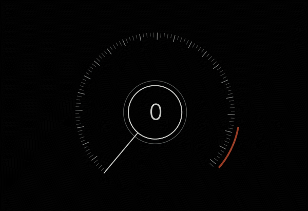
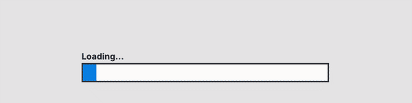
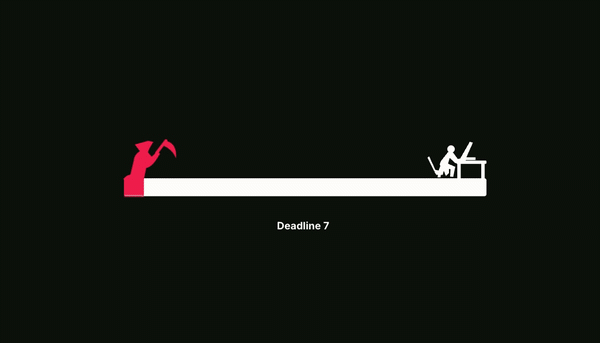
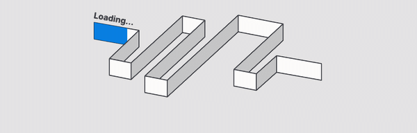

<!-- Generated by .github/scripts/build_catalog.py. Edit that file, not this one. -->
# Progress bars

Progress bars and rings.

Part of [UI](../).

## Designs (4)

<table>
<tr><td align="center" valign="top" width="33%"> <a href="aurora-speedometer/"><b>Aurora speedometer</b></a> 8 colorways</td><td align="center" valign="top" width="33%"> <a href="cobalt-outlined-progress/"><b>Cobalt outlined progress</b></a> 8 colorways</td><td align="center" valign="top" width="33%"> <a href="crimson-deadline-countdown/"><b>Crimson deadline countdown</b></a> 8 colorways</td></tr>
<tr><td align="center" valign="top" width="33%"> <a href="folded-cobalt-progress-ribbon/"><b>Folded cobalt progress ribbon</b></a> 8 colorways</td></tr>
</table>

Adding one? See [Adding a design](../../README.md#adding-a-design).
