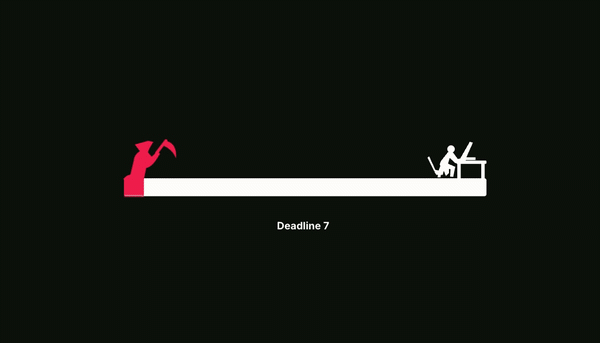
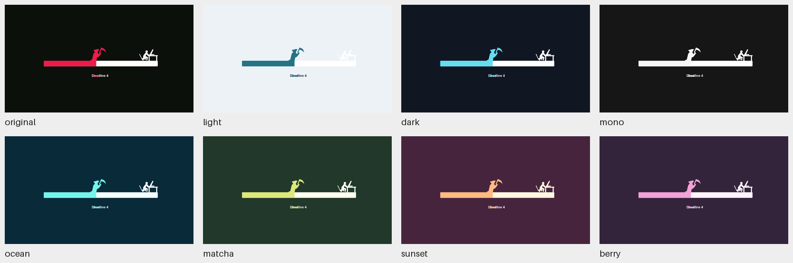

# Crimson deadline countdown

A crimson hooded timekeeper moves along a white progress track towards a tiny seated worker. Its arm swings as the deadline counts down below.

| | |
| --- | --- |
| **Category** | [UI › Progress bars](../) |
| **Size** | 576 × 329 CSS pixels, exported at 2× |
| **Colorways** | original, light, dark, mono, ocean, matcha, sunset, berry |
| **Fonts** | Inter, bundled under the SIL Open Font License |
| **Artwork** | Original two-character silhouette illustration, desk and moving progress bar. |
| **Animated** | Yes, 10.5833-second loop at 24 fps |
| **Based on** | [A TikTok by @paulcodes4](https://www.tiktok.com/@paulcodes4/video/7694924799163895061) |

## Every colorway

## Files

- [Open the standalone design](source/design.html). Select the scene to replay the loop.
- Add `#ocean` to switch palettes or `?t=4.5#ocean` to freeze the animation.
- [Exports](exports/) holds the colorway PNGs and H.264 loops.

## Changing it

Edit the palette variables at the top of [the source](source/design.html), then run `python3 .github/scripts/export_design.py ui/progress-bars/crimson-deadline-countdown` from the repository root.
