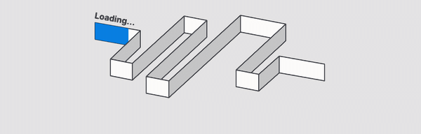
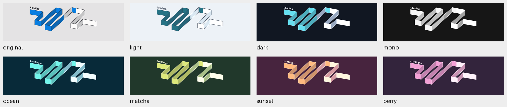

# Folded cobalt progress ribbon

A continuous ribbon folds through a shallow isometric zigzag. The cobalt fill rounds each corner in the same stepped progression as its flat companion.

| | |
| --- | --- |
| **Category** | [UI › Progress bars](../) |
| **Size** | 576 × 184 CSS pixels, exported at 2× |
| **Colorways** | original, light, dark, mono, ocean, matcha, sunset, berry |
| **Fonts** | Inter, bundled under the SIL Open Font License |
| **Artwork** | Original vector outlines and independently tinted ribbon faces. |
| **Animated** | Yes, 10-second loop at 24 fps |
| **Based on** | [A TikTok by @paulcodes4](https://www.tiktok.com/@paulcodes4/video/7696152427006872853) |

## Every colorway

## Files

- [Open the standalone design](source/design.html). Select the scene to replay the loop.
- Add `#ocean` to switch palettes or `?t=6.5#ocean` to freeze the animation.
- [Exports](exports/) holds the colorway PNGs and H.264 loops.

The reference also shows [Cobalt outlined progress](../cobalt-outlined-progress/), synchronized to the same progress.

## Changing it

Edit the palette variables at the top of [the source](source/design.html), then run `python3 .github/scripts/export_design.py ui/progress-bars/folded-cobalt-progress-ribbon` from the repository root.
